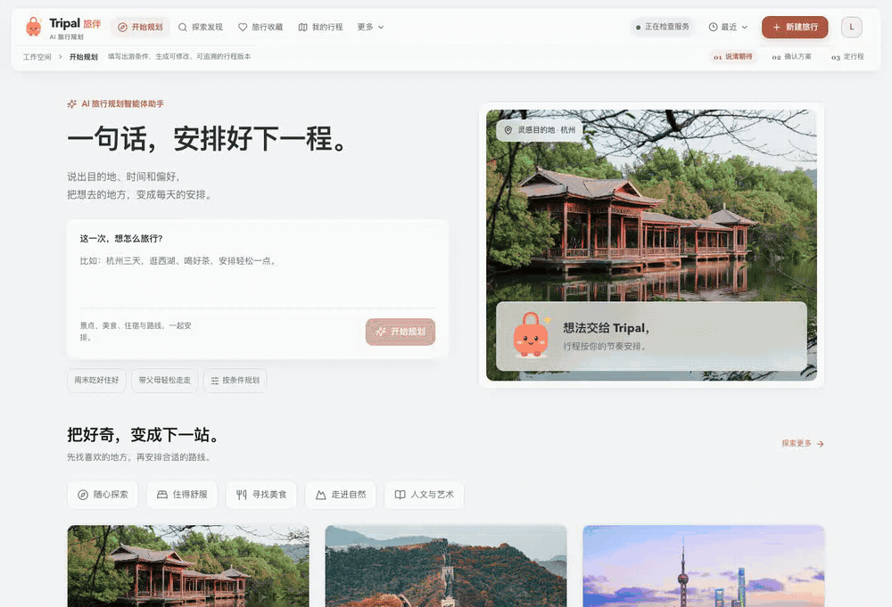
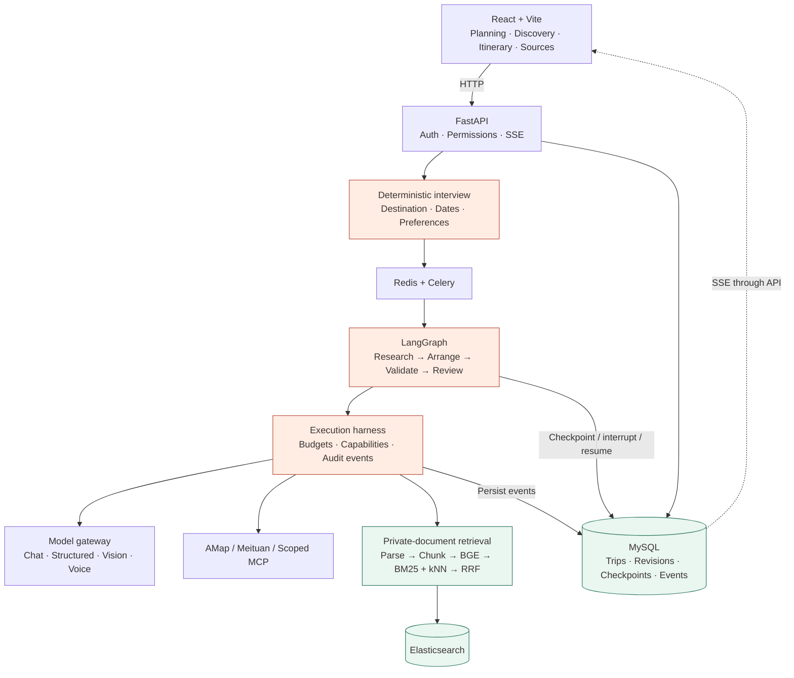
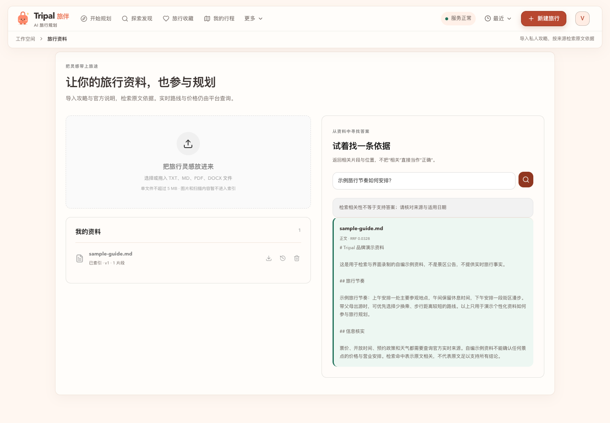

<div align="center">
  
  <p>
    
    
    
    
    
    <a href="#-license"></a>
  </p>
  <p><a href="README.md">简体中文</a> | <strong>English</strong></p>
</div>

Tripal turns travel requirements into editable, day-by-day itineraries for trips in China.
It combines conversational planning, destination discovery, route checks and private-document
retrieval, with sources and unknown facts kept visible.

<p align="center"><a href="docs/assets/demo/tripal-demo.webm"></a></p>
<p align="center"><sub>HD screen recording · Main features in their normal usage order, with a live Amap and real place/document data; itinerary is local demo data · <a href="docs/assets/demo/tripal-demo.webm">Watch HD video</a></sub></p>

## ✨ Features

| | What you can do | How it works |
|---|---|---|
| 💬 | **Describe a trip** | Extract destination, dates, budget and preferences; a deterministic interview asks for missing essentials. |
| 🧭 | **Compare and refine plans** | A bounded LangGraph workflow researches, arranges and validates itineraries; changes retain versions. |
| 🗺️ | **Explore continuously** | Places, food and stays load in real pages as you scroll; failed pages can be retried without losing earlier results. A sticky map uses about 58% of the desktop workspace. |
| 🍜 | **Plan meals and stays** | Replace meals, browse paged hotel candidates, save a selected stay with version checks, and inspect transport details. |
| 📚 | **Use your own documents** | Import TXT, MD, PDF or DOCX; BGE embeddings + Elasticsearch BM25/kNN + RRF return original excerpts and anchors. |
| 🔎 | **Check the evidence** | Inspect provider, retrieval time and source links. Missing prices and opening hours stay unverified. |
| 📖 | **Take a route book** | Preview a route book, export PDF/Markdown, and check that downloaded route books are valid PDF files. |
| 🔐 | **Keep control** | Per-user document access, trip roles, scoped MCP tools, task budgets and an append-only event trail. |

> Without model/map credentials, explicitly select **synthetic data** to exercise the flow.
> These fixtures demonstrate the engineering workflow and cannot support real travel decisions.
> Booking integrations create intents; they do not pay for reservations.

## 🏗️ Architecture



Research results are evidence, not instructions. Owner/version filters constrain retrieval;
validation and review precede a saved revision. Details: [design decisions](docs/架构与设计取舍.md),
[features and engineering checks](docs/功能与工程验证.md), [model gateway](docs/模型网关与Provider切换.md).

## 🚀 Quickstart

### 1. Prerequisites

- **Python 3.11** (`>=3.11,<3.12`).
- **Node.js 22+ and npm**; this visual update was built using Node.js 24.10.
- **Docker with Compose**, running before you launch the app.
- Optional model credentials and AMap Web Service / JS keys for live planning and maps.

### 2. Install

```bash
git clone https://github.com/JingleiCui/TripPal.git
cd TripPal
python3.11 scripts/bootstrap.py
```

Bootstrap creates `.venv`, installs the Python lockfile and both npm projects, and creates
`config.local.json` **only if absent**. Run these commands from the repository root.

### 3. Configure

Open `config.local.json` in your editor. The generated configuration has no credentials and
allows synthetic-data mode. For live planning, configure the active model profile's
`model_api_key`, set `model_enabled` to `true`, and fill in `amap_key`, `amap_js_key` and
`amap_security_code` as required. Restart after editing. `TRAVEL_<SETTING_NAME>` environment
variables override file values. Keep credentials in the ignored local file.

```bash
# Configuration validation only; no provider network calls.
.venv/bin/python scripts/check_providers.py --all-profiles
```

[Platform keys](docs/平台申请与配置.md) · [Provider/slot configuration](docs/模型网关与Provider切换.md)

### 4. Run

```bash
.venv/bin/python run_project.py
```

The launcher starts Compose services, waits for MySQL, applies migrations, sets up graph
checkpoints, builds the frontend and starts Celery + Uvicorn. Register a local account, select
**New trip → synthetic-data experience** for a credential-free planning demo, then send:

```text
去北京玩三天，两个人，总预算3000元，喜欢历史文化，少走路，直接规划。
```

Open [the app](http://127.0.0.1:8808/) or [API docs](http://127.0.0.1:8808/docs).
For PyCharm, select `.venv/bin/python` and run `run_project.py` directly; its configuration is
at the top of the file. Stop with Ctrl+C or `.venv/bin/python stop_project.py`.

| Service | Local port |
|---|---|
| App / Vite development | `8808` / `8809` |
| MySQL / Redis / Elasticsearch | `13316` / `16389` / `19220` |
| Mailpit inbox | `18026` |

<details>
<summary>Development & checks</summary>

```bash
# Requires the local service stack for integration cases.
.venv/bin/python -m pytest -q
.venv/bin/ruff check backend migrations
npm run build --prefix frontend
npm run dev --prefix frontend
# In another terminal, against the running app:
npm run test:e2e --prefix frontend
```

The browser suite uses installed Chrome. See [verification history](docs/验收结果.md) and
[deployment](docs/部署与运维.md) for operational details. These commands describe checks;
this README does not claim that every integration test ran during this visual update.
</details>

## 📁 Project structure

```text
TripPal/
├── backend/
│   ├── travel_agent/          # FastAPI application and domain logic
│   │   ├── agent/            # LangGraph workflow, harness and structured output
│   │   ├── models/           # Provider registry and model gateway
│   │   ├── providers/        # AMap, commerce, booking and explicit fixtures
│   │   ├── mcp/              # Scoped JSON-RPC / stdio tool server
│   │   ├── parsers/          # Order, GPX and screenshot parsing
│   │   ├── interview.py      # Slot merging and deterministic interview gate
│   │   ├── roles.py          # Trip membership role checks
│   │   ├── signals.py        # Behavioral signal aggregation and portrait
│   │   └── variants.py       # Candidate comparison decision
│   └── tests/                # Backend unit and integration tests
├── frontend/
│   ├── src/                  # HomeDiscovery, paged Discovery/HotelSelector and itinerary screens
│   ├── public/               # City photos and canonical logo favicon
│   ├── design/               # Earlier design tokens and references
│   └── e2e/                  # Playwright browser flows
├── integrations/             # Official Meituan CLI npm dependency
├── migrations/               # Alembic database migrations
├── scripts/                  # Bootstrap, checks, capture, evaluation and backup
├── docs/                     # Design, configuration and operations guides
│   └── assets/               # Project logos, concepts, screenshots and demo
├── eval/                     # Evaluation cases and instructions
├── config.example.json       # Safe local configuration template
├── requirements.lock.txt     # Pinned Python dependencies
├── compose.yaml              # Local database, queue, search and mail services
├── run_project.py            # IDE-friendly launcher with in-code configuration
└── stop_project.py           # Shutdown limited to this project's processes
```

`.venv/`, `node_modules/`, `data/`, `reports/`, local secrets and build outputs are ignored.

## 🧪 Examples & evidence

**Real retrieval, inspectable source.** A self-authored [sample document](docs/assets/demo/sample-guide.md)
is uploaded and indexed; search returns the original filename, text anchor, RRF score and
excerpt. The sample is labelled demonstration content and makes no live travel claims.



**Running discovery workspace.** Real Hangzhou POI results and AMap markers, with the larger
map beside the scrollable list. Results arrive 20 at a time, with ID deduplication, filter reset,
loading feedback and an explicit end state. The hotel picker also loads additional pages.


AMap exposes a bounded result window for each search; narrowing the city, category or keyword
starts a new query. See [AMap POI documentation](https://lbs.amap.com/api/webservice/guide/api-advanced/search).

This update passed **39 related backend tests and 7 browser tests**, plus the frontend build.
The [verification record](docs/assets/demo/core-ui-checks.json) states the exact scope; these are
engineering checks, not a live-model travel-quality benchmark.

<details>
<summary>More running-app screenshots & reproduction</summary>

- [Plan comparison](docs/assets/ui/recommendations.png) · [Saved itinerary](docs/assets/ui/itinerary.png)
- [Provider/time sources panel](docs/assets/ui/sources.png) · [Mobile homepage](docs/assets/ui/home-mobile.png)
- [Browser verification](docs/assets/demo/verification.json)

```bash
# With the application and containers running; creates an isolated local QA account.
node scripts/capture_brand_demo.mjs
```

The capture script uses synthetic planning, real document upload/retrieval and no API mocks.
It saves PNGs and a WebM recording; [the media guide](docs/brand-guide.md#demo-reproduction)
contains the GIF conversion command. No live model or booking quality benchmark is implied.
</details>

## 📄 License

This project is licensed under the **GNU Affero General Public License v3.0 (AGPL-3.0)**.
See the root [LICENSE](LICENSE) for the full text.

Copyright (c) 2026 崔静蕾.

AGPL-3.0 permits copying, modification and redistribution, including commercial use. If you
modify the project and make it available to users over a network, you must offer the corresponding
source code under AGPL-3.0. The project is mainly intended for learning and exchange; please
honor the source-disclosure obligation when offering it as an online service.
