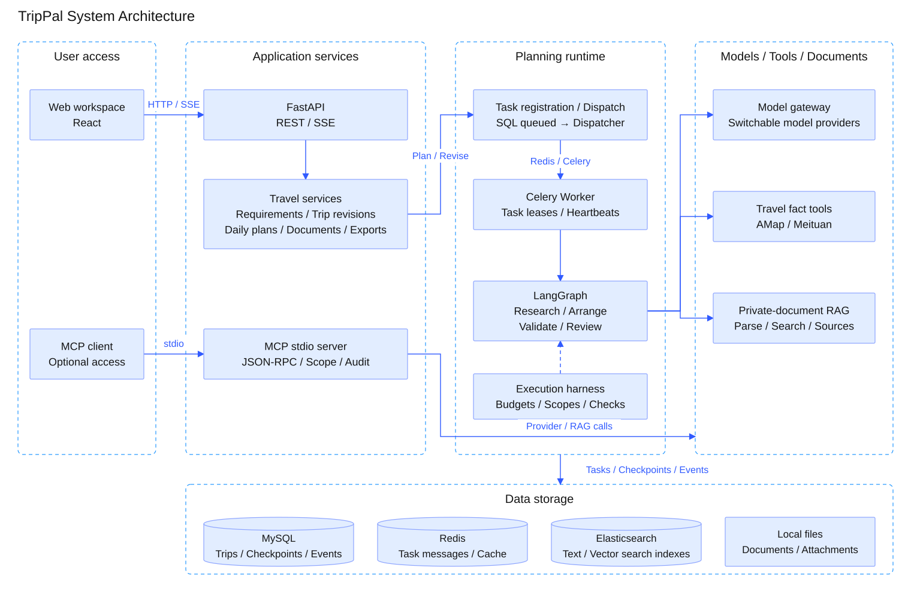
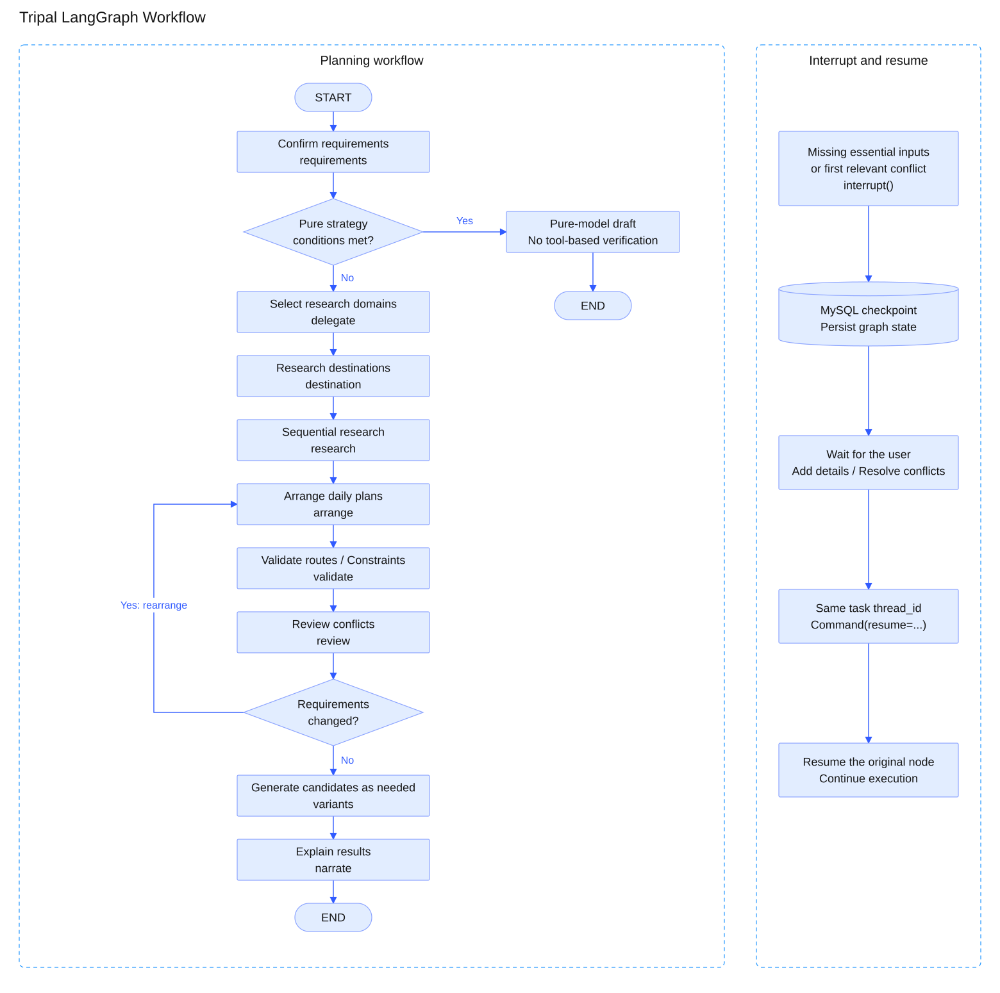
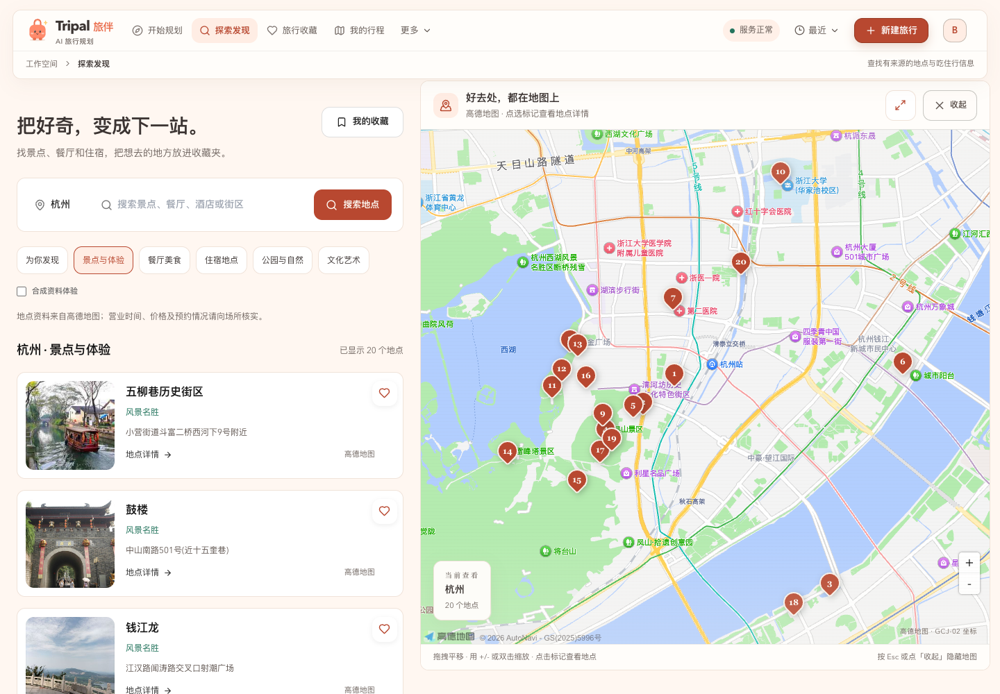

<div align="center">
  
  <p>
    
    
    
    
    
    <a href="#-license"></a>
  </p>
  <p><a href="README.md">简体中文</a> | <strong>English</strong></p>
</div>

**TripPal is a self-hosted AI travel-planning agent for trips within China.** Describe your destination, dates, budget and preferences to start planning. TripPal gathers missing essentials, researches places and routes, consults your own travel documents, and creates an editable daily itinerary.

Compare candidate plans, lock places you want to keep, arrange meals, stays and transport, then export a travel guide from the same workspace. Places and routes retain their sources, edits retain itinerary versions, and unsupported prices, opening hours and reservation details are marked for verification.

<p align="center"><a href="docs/assets/demo/tripal-demo.webm"></a></p>
<p align="center"><sub>Local app recording: synthetic itineraries, a live AMap and sample-document retrieval · <a href="docs/assets/demo/tripal-demo.webm">Watch HD video</a></sub></p>

## ✨ Features

| Feature | What it does |
|---|---|
| 💬 **Conversational planning** | Collect destinations, dates, budget and preferences; ask for missing essentials. |
| 🧭 **Plan comparison and refinement** | Research candidate places, arrange daily itineraries and validate constraints. Compare plans when needed, lock places and keep refining. |
| 🗺️ **Maps and discovery** | Browse attractions, food and stays beside a large map. Load more as you scroll, retain earlier results and retry failed pages. |
| 🍜 **Daily travel services** | Inspect transport and costs, replace restaurants and browse accommodation pages. Version checks protect saved changes. |
| 📚 **Private-document retrieval** | Import TXT, MD, PDF or DOCX. BGE embeddings and Elasticsearch hybrid search return excerpts with their original locations. |
| 🔎 **Inspectable sources** | Check providers, query times and links for places, routes and other supported information. Missing details remain explicit. |
| 📖 **Travel guides and exports** | Preview daily plans, share itineraries and export PDF or Markdown. |
| 🔐 **Access and execution controls** | Isolate documents by user, control trip access through member roles, and constrain tool execution through MCP scopes, call budgets and event records. |

For a credential-free introduction, select **使用合成资料体验** (synthetic-data experience) when creating a trip. Synthetic content demonstrates the planning and editing flow; live place queries and maps require AMap configuration. Booking integrations record intent without placing orders or making payments.

## 🏗️ Architecture

### System overview

The React workspace sends REST requests and receives execution updates through SSE. FastAPI handles authentication, trip permissions and business operations. Planning and revision tasks are written to MySQL before a dispatcher delivers them through Redis / Celery to a Worker. LangGraph coordinates planning; the execution harness applies call budgets, tool permissions and execution checks.



[Full-size diagram](docs/assets/architecture/structured/01-overall.en.svg) · [Editable draw.io source](docs/assets/architecture/structured/01-overall.en.drawio)

MySQL stores tasks, itinerary versions, checkpoints and events. Redis handles messages and temporary caches; Elasticsearch holds rebuildable search indexes. Private-document retrieval respects user and document-version boundaries. The optional MCP stdio entry point can call providers and RAG directly without running the planning graph.

### LangGraph workflow

The default path confirms requirements, selects research domains, investigates destinations, performs additional research, arranges daily plans, validates routes and reviews conflicts. Research domains run sequentially. Changed requirements return the workflow to itinerary arrangement.



[Full-size diagram](docs/assets/architecture/structured/03-langgraph.en.svg) · [Editable draw.io source](docs/assets/architecture/structured/03-langgraph.en.drawio)

The graph can pause for missing information or a user decision, persist a checkpoint, and resume the original node using `Command(resume=...)` on the same task. Candidate generation is conditional: two distinct plans are not guaranteed. Plan selection and final version commits happen outside the graph in the Worker / API. Restoring a checkpoint does not replace permission, lease and version checks before saving.

Further reading: [other architecture views](docs/architecture/README.md), [design decisions](docs/架构与设计取舍.md), and [model gateway and provider configuration](docs/模型网关与Provider切换.md).

## 🚀 Quickstart

### 1. Prerequisites

Commands below use macOS / Linux paths.

- **Python 3.11** (`>=3.11,<3.12`).
- **Node.js 22+ and npm**.
- **Docker with Compose**, running before you launch the app.
- A configured model service for live planning, and AMap keys for live place queries and maps.

### 2. Install

```bash
git clone https://github.com/JingleiCui/TripPal.git
cd TripPal
python3.11 scripts/bootstrap.py
```

Bootstrap creates `.venv`, installs pinned Python dependencies and the `frontend` and `integrations` npm dependencies, then creates `config.local.json` from the template if it does not already exist. Run subsequent commands from the repository root.

### 3. Configure

For an initial demo, keep the defaults and explicitly select synthetic data in the UI. To connect live services, edit the Git-ignored `config.local.json`:

| Purpose | Configuration |
|---|---|
| Model planning | Select a `model_profiles` entry with `active_model_profile`. Set `model_api_key`, an available model name and `model_enabled: true` inside that profile. |
| Places, routes and weather | Set the top-level `amap_key` to an AMap Web Service key. |
| Map display | Set the top-level `amap_js_key` and `amap_security_code` for the JS API. |
| Meituan queries (optional) | Configure official CLI credentials and enable `meituan_enabled`; see [platform setup](docs/平台申请与配置.md#5-美团酒旅推荐). |

Restart the application and Worker after editing. `TRAVEL_<SETTING_NAME>` environment variables override file configuration. Check configuration parsing with:

```bash
# Does not call model APIs or verify credentials, quota or model availability.
.venv/bin/python scripts/check_providers.py --all-profiles
```

Details: [platform setup](docs/平台申请与配置.md) and [model profiles and capability slots](docs/模型网关与Provider切换.md).

### 4. Run

```bash
.venv/bin/python run_project.py
```

The launcher starts Compose services, waits for MySQL, runs migrations, initializes graph checkpoints, builds the frontend when needed, and starts the Celery Worker and Uvicorn.

Open [the app](http://127.0.0.1:8808/), create a local account, and choose **新建旅行 → 使用合成资料体验** (New trip → synthetic-data experience). Try:

```text
去北京玩三天，两个人，总预算3000元，喜欢历史文化，少走路，直接规划。
```

This asks for three days in Beijing for two people, a total budget of CNY 3,000, a focus on history and culture, and less walking. The current UI is in Chinese.

In PyCharm, select `.venv/bin/python` and run `run_project.py` directly; common settings such as the port are at the top of the file. API docs are at [http://127.0.0.1:8808/docs](http://127.0.0.1:8808/docs).

| Service | Local port |
|---|---|
| Application / Vite development server | `8808` / `8809` |
| MySQL / Redis / Elasticsearch | `13316` / `16389` / `19220` |
| Mailpit inbox | `18026` |

Stop application processes with **Ctrl+C** or `.venv/bin/python stop_project.py`. Containers keep running; use `docker compose stop` from the repository root to stop this project's containers.

<details>
<summary>Enable private-document retrieval</summary>

Indexing and retrieval require Elasticsearch and a local BGE model. The default `embedding_local_only: true` loads cached models only. Before first use, run this once with access to the model repository:

```bash
.venv/bin/python -c "from sentence_transformers import SentenceTransformer; SentenceTransformer('BAAI/bge-small-zh-v1.5', device='cpu')"
```

This downloads and caches the default embedding model. Restart the application and Worker, upload a file on the **资料** (Documents) page, and wait for **已索引** (Indexed) before searching. Check index configuration before changing the embedding model or dimensions.
</details>

<details>
<summary>Development, tests and deployment</summary>

Keep the application and Compose services running, then use another terminal:

```bash
.venv/bin/python -m pytest -q
.venv/bin/ruff check backend migrations
npm run build --prefix frontend
npm run test:e2e --prefix frontend
```

For frontend hot reload, run `npm run dev --prefix frontend` and open `http://127.0.0.1:8809/`. Browser tests use installed Chrome and target port `8808` by default.

The full test suite may require cached models and configured external services; see [features and engineering checks](docs/功能与工程验证.md). Server setup is covered in [deployment and operations](docs/部署与运维.md).
</details>

## 📁 Project structure

```text
TripPal/
├── backend/
│   ├── travel_agent/         # FastAPI application and domain logic
│   │   ├── agent/            # LangGraph, execution harness and structured output
│   │   ├── models/           # Model registry, providers and invocation gateway
│   │   ├── providers/        # AMap, Meituan, booking intents and synthetic data
│   │   ├── mcp/              # Scoped, audited stdio tool server
│   │   ├── parsers/          # Order, GPX and screenshot parsing
│   │   ├── knowledge.py      # Document parsing, chunking and hybrid retrieval
│   │   ├── interview.py      # Requirement merging and question gating
│   │   └── worker.py         # Async tasks, leases and version commits
│   └── tests/                # Backend unit and integration tests
├── frontend/
│   ├── src/                  # Planning conversations, discovery maps and daily plans
│   ├── public/               # City images and logo favicon
│   └── e2e/                  # Playwright browser tests
├── integrations/             # Official Meituan CLI npm dependency
├── migrations/               # Alembic database migrations
├── scripts/                  # Bootstrap, checks, recording, diagrams and backups
├── docs/                     # Design, configuration, verification and operations
│   ├── architecture/         # Architecture documentation and diagram collection
│   └── assets/               # Logo, demos, screenshots and editable diagrams
├── eval/                     # Evaluation cases and instructions
├── config.example.json       # Local configuration template without credentials
├── requirements.lock.txt     # Pinned Python dependencies
├── compose.yaml              # Local database, messaging, search and mail services
├── run_project.py            # IDE-friendly launcher
└── stop_project.py           # Stops application processes owned by this project
```

Local configuration, credentials, `.venv/`, `node_modules/`, `data/`, `reports/` and build outputs are Git-ignored.

## 🧪 Examples and verification

### Private-document retrieval and provenance

Upload and index the self-authored [sample guide](docs/assets/demo/sample-guide.md) to reproduce retrieval. Results show the filename, original location, RRF score and text excerpt.


### Place discovery and maps

The screenshot below shows Hangzhou place results alongside AMap. Each page loads 20 items; scrolling appends and deduplicates results. Filters start a new query, failed pages can be retried, and loading stops at the last available page. The accommodation picker also supports additional pages.



AMap limits the result window for each query. Narrow the city, category or keyword to search further; see [API documentation](https://lbs.amap.com/api/webservice/guide/api-advanced/search).

The included [verification record dated 2026-11-17](docs/assets/demo/core-ui-checks.json) reports **39 related backend tests, 7 browser tests and a passing frontend build**. Coverage includes discovery pagination, retry, deduplication, responsive layout and accommodation selection. This records engineering checks rather than live-model planning quality.

<details>
<summary>More screenshots and demo reproduction</summary>

- [Plan comparison](docs/assets/ui/recommendations.png) · [Saved itinerary](docs/assets/ui/itinerary.png)
- [Sources panel](docs/assets/ui/sources.png) · [Mobile homepage](docs/assets/ui/home-mobile.png)
- [Browser verification record](docs/assets/demo/verification.json)

With the application and containers running and the BGE model cached:

```bash
node scripts/capture_brand_demo.mjs
```

The script creates an isolated local QA account, uses synthetic itineraries, and performs actual document upload, indexing and retrieval without intercepting API requests. It saves screenshots and WebM; GIF conversion commands are in the [media guide](docs/brand-guide.md#demo-reproduction).
</details>

## 📄 License

This project is licensed under the **GNU Affero General Public License v3.0 (AGPL-3.0)**. See [LICENSE](LICENSE) for the full terms.

Copyright (c) 2026 崔静蕾.
