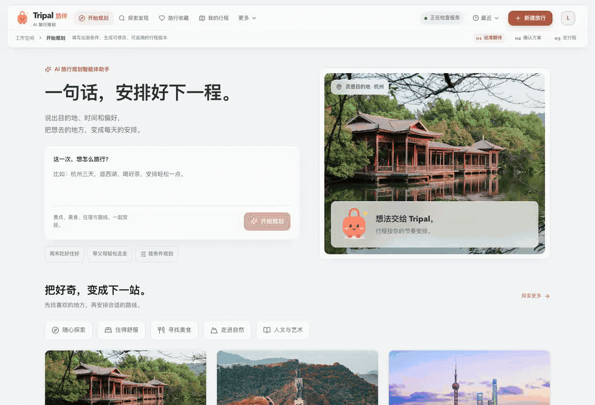
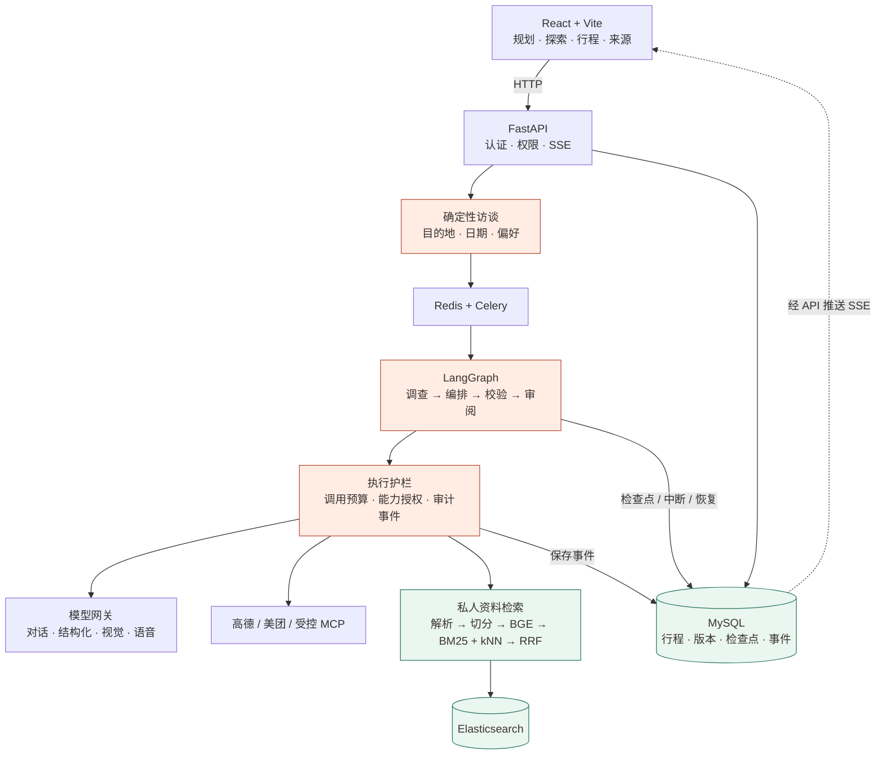
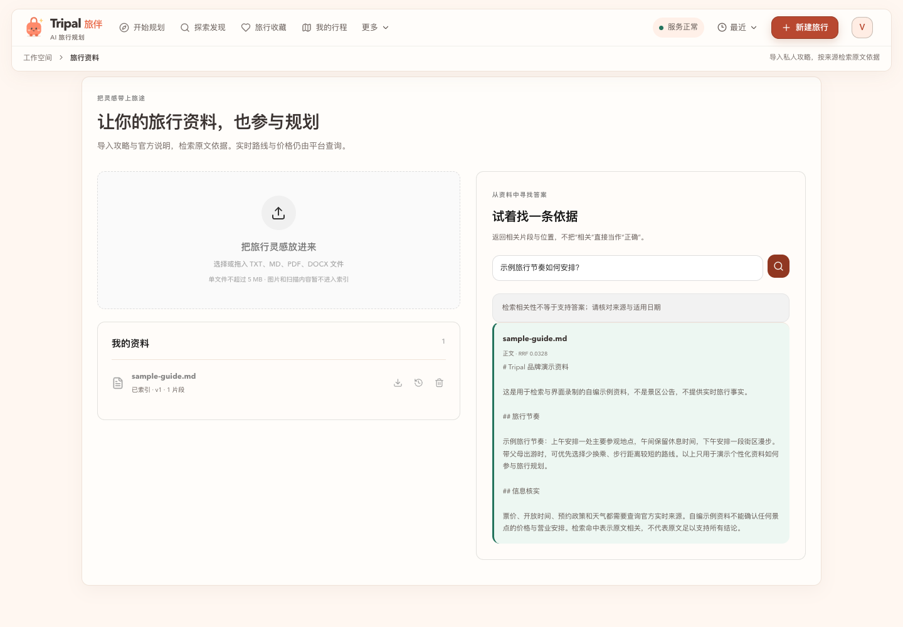
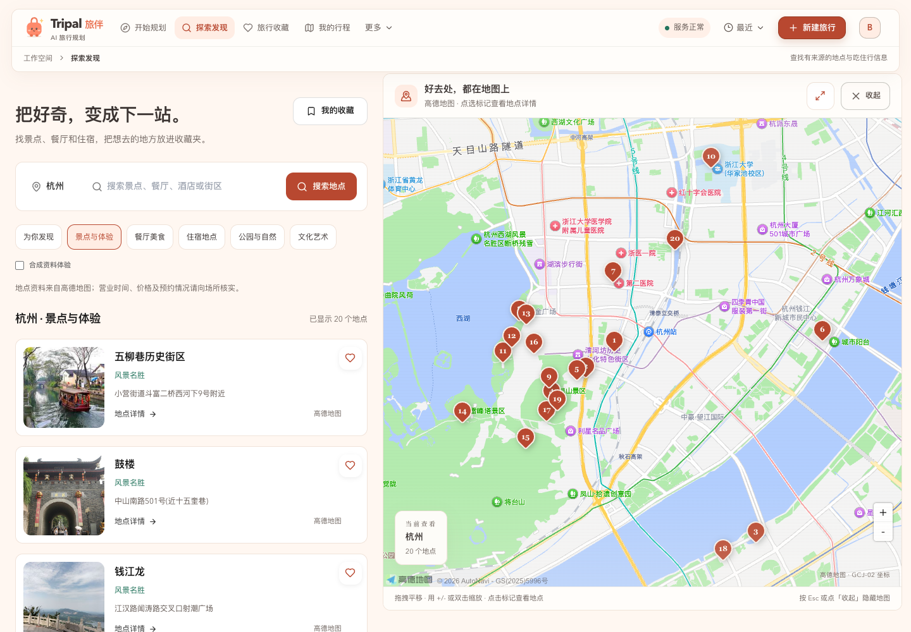

<div align="center">
  
  <p>
    
    
    
    
    
    <a href="#-license"></a>
  </p>
  <p><strong>简体中文</strong> | <a href="README.en.md">English</a></p>
</div>

Tripal 将旅行需求整理为**可查看、可调整、保留来源的每日行程**，面向中国境内旅行场景。
通过对话收集日期、预算与偏好，结合地点探索、路线查询和私人资料检索，完成方案推荐与行程编排。
未知票价、开放时间和待确认事项会明确展示。

<p align="center"><a href="docs/assets/demo/tripal-demo.webm"></a></p>
<p align="center"><sub>真实页面高清录制 · 按正常使用顺序演示主要功能，地图为真实高德地图，地点与资料为真实资料，行程为本地演示数据 · <a href="docs/assets/demo/tripal-demo.webm">观看高清视频</a></sub></p>

## ✨ 核心特性

| | 能做什么 | 如何实现 |
|---|---|---|
| 💬 | **一句话描述需求** | 提取目的地、日期、预算和偏好；确定性访谈补齐必要条件，避免反复追问。 |
| 🧭 | **推荐、比较与调整方案** | LangGraph 有界工作流完成调查、编排和约束校验；修改保留行程版本。 |
| 🗺️ | **一直浏览，继续发现** | 景点、美食、住宿按真实分页随滚动追加；失败可重试，已有结果保留。桌面地图约占 58%，随列表滚动保持可见。 |
| 🍜 | **一起安排吃住行** | 查看餐饮与交通，替换餐厅；住宿选择窗口支持分页浏览，选择后校验版本并更新行程。 |
| 📚 | **让自己的资料参与规划** | 支持 TXT / MD / PDF / DOCX；BGE 向量 + Elasticsearch BM25/kNN + RRF，返回原文与位置。 |
| 🔎 | **查看每条信息的依据** | 展示来源平台、查询时间与原始链接；缺失的价格和开放信息保持待核实。 |
| 📖 | **带走一份旅行路书** | 路书预览、PDF / Markdown 导出；下载时检查返回文件的有效 PDF 标识。 |
| 🔐 | **控制数据与执行过程** | 用户资料隔离、行程角色权限、MCP scope、任务调用预算与追加式事件记录。 |

> 没有模型或地图凭证时，可主动选择**合成资料体验**，验证完整工程流程。
> 合成数据不能作为真实出行依据。预订集成记录预订意向，不执行付款。

## 🏗️ 系统架构



检索和工具结果作为证据使用；用户与文档版本过滤约束检索范围，校验与审阅之后再保存行程版本。
进一步阅读：[架构取舍](docs/架构与设计取舍.md) · [功能与工程验证](docs/功能与工程验证.md) · [模型网关](docs/模型网关与Provider切换.md)。

## 🚀 Quickstart

### 1. 前置条件

- **Python 3.11**，项目要求 `>=3.11,<3.12`。
- **Node.js 22+ 和 npm**；本轮视觉更新使用 Node.js 24.10 构建。
- **Docker 与 Compose**，运行项目之前先启动 Docker。
- 真实规划可选配模型凭证、高德 Web 服务 Key 与 JS Key。

### 2. 安装

```bash
git clone https://github.com/JingleiCui/TripPal.git
cd TripPal
python3.11 scripts/bootstrap.py
```

安装脚本建立 `.venv`、安装 Python 锁定依赖和两个 npm 项目，并且**仅在配置文件不存在时**
从模板创建 `config.local.json`。后续命令都在仓库根目录执行。

### 3. 配置

用编辑器打开 `config.local.json`。新生成的配置不含凭证，允许合成资料体验。
真实规划需要在当前模型 profile 中填写 `model_api_key`、设置 `model_enabled: true`，
再按需填写 `amap_key`、`amap_js_key` 和 `amap_security_code`。
修改后重启；`TRAVEL_<SETTING_NAME>` 环境变量优先于文件。凭证保存在已忽略的本地配置中。

```bash
# 只校验配置，不向模型平台发送请求。
.venv/bin/python scripts/check_providers.py --all-profiles
```

[平台申请与配置](docs/平台申请与配置.md) · [模型 profile / slot 配置](docs/模型网关与Provider切换.md)

### 4. 运行

```bash
.venv/bin/python run_project.py
```

启动器依次启动 Compose 服务、等待 MySQL、执行数据库迁移、初始化图检查点、构建前端，
再启动 Celery 和 Uvicorn。注册本地账户，进入**新建旅行 → 使用合成资料体验**，无需凭证即可试用：

```text
去北京玩三天，两个人，总预算3000元，喜欢历史文化，少走路，直接规划。
```

打开[应用首页](http://127.0.0.1:8808/)或 [API 文档](http://127.0.0.1:8808/docs)。
PyCharm 中选择 `.venv/bin/python`，直接运行 `run_project.py` 即可；常用配置在文件顶部。
按 Ctrl+C 或运行 `.venv/bin/python stop_project.py` 停止本项目进程。

| 服务 | 本地端口 |
|---|---|
| 应用 / Vite 开发服务 | `8808` / `8809` |
| MySQL / Redis / Elasticsearch | `13316` / `16389` / `19220` |
| Mailpit 测试邮箱 | `18026` |

<details>
<summary>开发与检查命令</summary>

```bash
# 集成用例需要先启动本地服务栈。
.venv/bin/python -m pytest -q
.venv/bin/ruff check backend migrations
npm run build --prefix frontend
npm run dev --prefix frontend
# 另开终端，针对已运行的应用执行：
npm run test:e2e --prefix frontend
```

浏览器用例使用已安装的 Chrome。历史验证范围见[验收结果](docs/验收结果.md)，服务器配置见
[部署与运维](docs/部署与运维.md)。这里提供复现命令，不表示本轮视觉更新运行了全部集成测试。
</details>

## 📁 项目结构

```text
TripPal/
├── backend/
│   ├── travel_agent/          # FastAPI 应用与领域逻辑
│   │   ├── agent/            # LangGraph、执行护栏和结构化输出
│   │   ├── models/           # 模型注册、平台适配与调用网关
│   │   ├── providers/        # 高德、美团、预订与显式合成资料
│   │   ├── mcp/              # 带权限范围的 JSON-RPC / stdio 工具服务
│   │   ├── parsers/          # 订单、GPX 与截图解析
│   │   ├── interview.py      # 槽位合并与确定性提问门控
│   │   ├── roles.py          # 行程成员角色判定
│   │   ├── signals.py        # 行为信号聚合与画像
│   │   └── variants.py       # 候选对比判定
│   └── tests/                # 后端单元与集成测试
├── frontend/
│   ├── src/                  # HomeDiscovery 首页、分页探索/住宿选择与行程界面
│   ├── public/               # 城市图片与正式 Logo favicon
│   ├── design/               # 历史设计令牌与参考页面
│   └── e2e/                  # Playwright 浏览器用例
├── integrations/             # 美团官方 CLI 的 npm 依赖
├── migrations/               # Alembic 数据库迁移
├── scripts/                  # 安装、自检、录制、评估与备份
├── docs/                     # 设计、配置与运维文档
│   └── assets/               # 随项目提供的 Logo、概念稿、截图与动图
├── eval/                     # 评估样例与使用说明
├── config.example.json       # 不含凭证的本地配置模板
├── requirements.lock.txt     # Python 依赖锁定
├── compose.yaml              # 本地数据库、队列、检索与邮件服务
├── run_project.py            # 文件顶部配置，支持 IDE 直接运行
└── stop_project.py           # 仅停止本项目持有的进程
```

`.venv/`、`node_modules/`、`data/`、`reports/`、本地密钥与构建产物不进入版本库。

## 🧪 效果示例与证据

**真实检索，可检查原文。** 上传并索引[自编示例资料](docs/assets/demo/sample-guide.md)后，
检索结果展示文件名、原文位置、RRF 分数与文本片段。示例文档明确标注为演示用途，不含实时旅行承诺。



**实际探索工作区。** 杭州真实地点与高德标记同屏展示，右侧地图独立占据更大的空间。
列表每次加载 20 条，滚动到底部继续追加；跨页去重，切换条件重置，失败可重试，末页明确停止。住宿选择窗口同样支持追加加载。



高德对同一查询提供有限的翻页范围，达到末页后可细化城市、分类或关键词继续探索，
详见[高德 POI 接口说明](https://lbs.amap.com/api/webservice/guide/api-advanced/search)。

本次更新通过 **39 项相关后端测试、7 项浏览器测试**及前端构建，
[验证记录](docs/assets/demo/core-ui-checks.json)列出具体范围；这些检查不代表真实模型规划质量评测。

<details>
<summary>更多运行截图与复现</summary>

- [候选方案比较](docs/assets/ui/recommendations.png) · [保存后的行程](docs/assets/ui/itinerary.png)
- [平台与时间来源面板](docs/assets/ui/sources.png) · [移动端首页](docs/assets/ui/home-mobile.png)
- [浏览器验证记录](docs/assets/demo/verification.json)

```bash
# 应用与容器运行后执行；会创建独立的本地 QA 账户。
node scripts/capture_brand_demo.mjs
```

录制脚本使用合成行程数据、真实资料上传与检索，不拦截或伪造 API。
输出 PNG 与 WebM；GIF 转换命令见[素材说明](docs/brand-guide.md#demo-reproduction)。
该演示不代表真实模型规划质量或预订效果评测。
</details>

## 📄 License

本项目采用 **GNU Affero General Public License v3.0（AGPL-3.0）**，完整条款见根目录 [LICENSE](LICENSE)。

