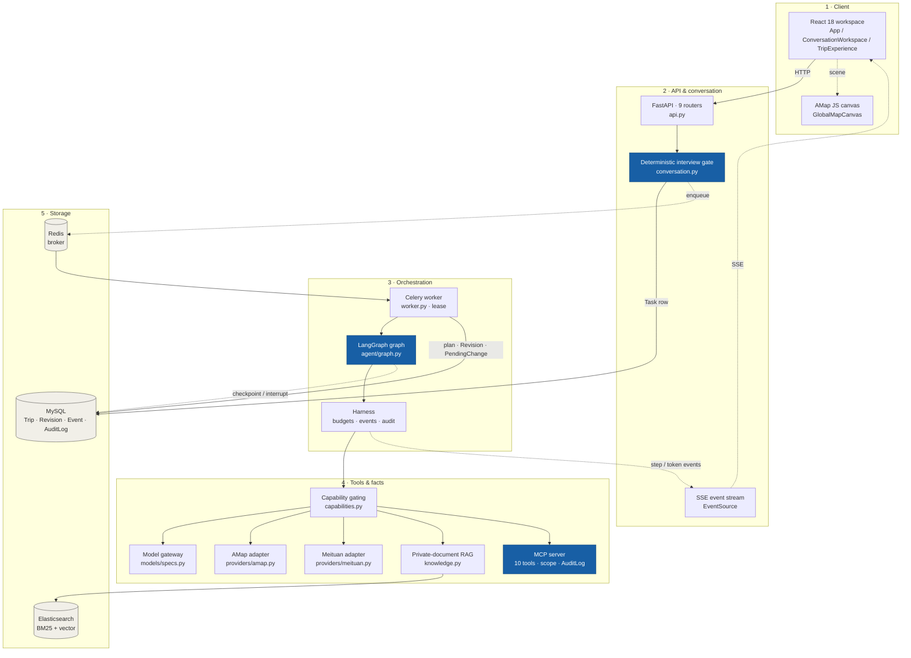
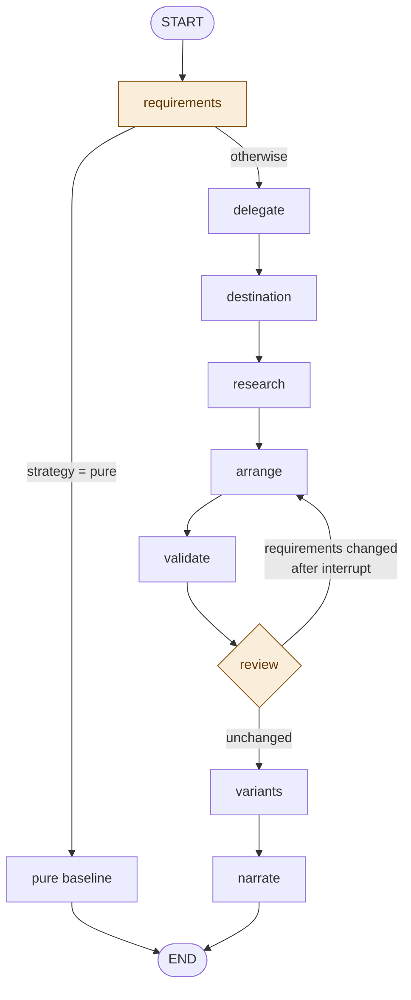
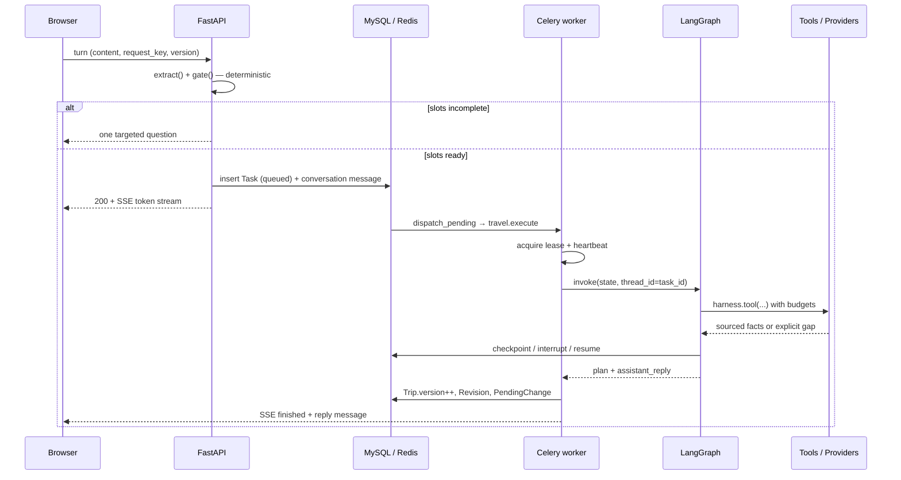
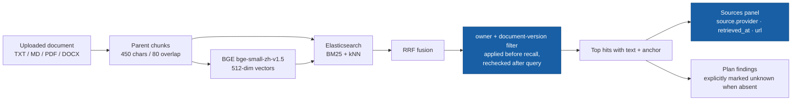

<div align="center">

# travel_agent

> **A travel-planning agent that refuses to invent facts.** Describe a trip in one sentence; every place, route and price in the resulting itinerary carries its source — and when a source is missing, the plan says *unknown* instead of guessing.

</div>

<p align="center">
  <a href="https://img.shields.io/badge/Python-3.11-3776AB?logo=python&logoColor=white"></a>
  <a href="https://img.shields.io/badge/TypeScript-5.8-3178C6?logo=typescript&logoColor=white"></a>
  <a href="https://img.shields.io/badge/LangGraph-1.x-1D9E75"></a>
  <a href="https://img.shields.io/badge/FastAPI-0.115%2B-009688?logo=fastapi&logoColor=white"></a>
  <a href="https://img.shields.io/badge/React-18.3-61DAFB?logo=react&logoColor=black"></a>
  <a href="#-license"></a>
</p>

<p align="center">
  <strong>English</strong> · <a href="./README.zh-CN.md">简体中文</a>
</p>

---

## What it is

`travel_agent` is a self-hosted travel-planning application for trips in China. A short chat
turn is turned into a day-by-day itinerary by a **bounded LangGraph supervisor** that delegates
research to domain agents, calls real mapping and commerce adapters through tools, validates
the result against constraints, and writes a versioned plan. A React workspace renders the
conversation, the itinerary and a live AMap canvas side by side.

Two properties define the design. First, **the agent is not the router**: the interview that
collects destination, dates and duration is a deterministic, anti-loop gate implemented in
code, so it never silently invents a destination or a trip length. Second, **facts are not
free text**: tool output is treated as evidence, never as instructions; missing opening hours,
prices or coordinates stay explicitly unknown. When credentials for the model or the AMap Web
Service are absent, the system exposes a labelled synthetic fixture for exercising the
engineering flow — it does not quietly substitute fake travel data for real queries.

The stack is FastAPI + Celery + LangGraph with a MySQL checkpointer, Redis as broker,
Elasticsearch + BGE embeddings for private-document retrieval, and a React 18 / Vite
frontend. Model access goes through a pluggable gateway with nine built-in provider presets
(OpenRouter, DashScope/Qwen in OpenAI-compatible mode, generic OpenAI-compatible, SiliconFlow,
DeepSeek, Gemini, Ollama, DashScope native multimodal, and in-process local models) and
per-capability slots for chat, structured output, vision, ASR and TTS.

---

## Run it, in one screen

> **Media to supply:** this repository does not yet contain a recorded demo GIF, a logo, or
> UI screenshots (the only tracked images are four decorative city photos in
> `frontend/public/images/`). No image or video URL is fabricated below. Until a recording is
> added, the following is the **actual, reproducible first-screen evidence**: the ten governed
> MCP tools served over stdio, and the real command that produces them.

One command starts the governed MCP server; an `initialize` + `tools/list` exchange returns
the scoped tool surface:

```bash
PYTHONPATH=backend .venv/bin/python -m travel_agent.mcp.server
```

```text
→ initialize   protocolVersion 2024-11-05 · serverInfo travel-agent-mcp 0.1.0
→ tools/list   10 tools, each tagged with a travel_agent:<capability> scope
   amap_search_places    travel_agent:maps        amap_poi_detail     travel_agent:maps
   amap_route            travel_agent:maps        amap_distance_matrix travel_agent:maps
   amap_traffic_route    travel_agent:maps        amap_weather        travel_agent:weather
   meituan_query         travel_agent:meituan     meituan_food        travel_agent:dining
   knowledge_search      travel_agent:knowledge   booking_intent      travel_agent:lodging
→ every tools/call is checked against granted scopes and written to AuditLog (actor=mcp)
```

The same governance runs inside the agent: a single task emits an append-only `Event` trace
(`step` / `model_start` / `model_end` / `tool_start` / `tool_end` / `assistant_token` /
`variant_ready` / `finished`) that the frontend consumes over SSE. A representative run:

```text
  ● POST /api/v1/conversations/{id}/turns   → deterministic gate: destination / dates / days
  ● Task queued → Celery lease acquired → LangGraph resume from MySQL checkpoint
  ● step  需求确认 → 主 Agent 安排调查 → 目的地调查
  ● tool_start  amap_places → tool_end  success
  ● step  安排每日行程 → 查询实际路线并检查约束
  ● assistant_token × N  → SSE streamed into the chat
  ✓ finished  status=completed · Revision + PendingChange written
```

---

## ✨ Features

> Scannable summary. Every row below corresponds to code and tests in this repository.

| | Capability | What is actually implemented |
|---|---|---|
| 🧭 | Deterministic interview | Rule-based slot extraction (city, days, relative dates such as “下周三-下周五”, budget, interests) merged with structured model extraction; code-driven anti-loop gate asks one question at a time and never defaults destination or duration |
| 🕸️ | Bounded LangGraph | Supervisor + domain agents over `requirements → delegate → destination → research → arrange → validate → review → variants → narrate`; persistent `interrupt()` for missing dates and constraint trade-offs; MySQL checkpoint and `Command(resume=...)` |
| 🔒 | Execution harness | Per-task model-call limit (12), tool-call limit (24), time budget (600 s), lease + heartbeat, optimistic trip versioning, append-only `Event` audit trail, capability-gated tool exposure |
| 🛰️ | Governed MCP server | Self-implemented JSON-RPC over stdio: `initialize` / `ping` / `tools/list` / `tools/call`, 10 tools, per-tool `travel_agent:<capability>` scope checks, `AuditLog` on every call |
| 🗺️ | Real spatial facts | AMap Web Service adapter: POI search and detail, walking/transit/driving routes, distance matrix, traffic-aware routes, weather, geocoding; GCJ-02 preserved; front-end AMap JS canvas with markers and routes |
| 🍜 | Dining & commerce | AMap POI food search with non-restaurant filtering, Meituan CLI adapters for food recommendations, deals, and hotel/ticket/transport queries; missing configuration degrades to an empty result, never to fabricated prices |
| 📚 | Private-document RAG | TXT / MD / PDF / DOCX parsing, 450/80-character parent chunking, BGE `bge-small-zh-v1.5` 512-dim vectors, Elasticsearch BM25 + kNN hybrid retrieval with RRF fusion, owner and document-version filters applied before recall, recheck after query |
| 🔍 | Source traceability | Every stop carries `source.provider` / `retrieved_at` / `url`; a dedicated **Sources** panel lists the origin of each fact; plans retain `verification`, `warnings` and unknown-cost items |
| 🧩 | Agent-capability layer | Capability gating maps `maps / weather / dining / meituan / lodging / knowledge` to tool sets; per-change **undo window** cards (15-minute TTL) with `Revision`-based restore; attachment-driven suggestions for orders, GPX tracks and screenshots; structured booking *intents* only — no payment |
| 🧠 | Pluggable model gateway | 9 built-in provider presets plus custom `model_providers`; per-slot `chat / structured / vision / asr / tts` assignment; structured output via `json_schema` or `function_calling` with **one** bounded correction and no invented fallback |
| 👥 | Account & collaboration | Registration, password hashing, persistent sessions, CSRF, JWT with revocation, per-user isolation, owner/editor/viewer trip membership, read-only sharing, PDF/Markdown export, privacy export and account deletion |
| ✅ | Verified engineering | 25 backend test modules (153 test functions), 6 Playwright spec files, frontend `tsc --noEmit` and Vite build, dependency and platform self-check scripts |

---

## 🏗️ Architecture

All four diagrams are GitHub-renderable Mermaid; the design conventions (layering, colour
tokens, arrow semantics, source traceability checklist) are documented in
[`docs/README架构图呈现方案.md`](./docs/README架构图呈现方案.md).

### A. System layers



### B. LangGraph control flow

Nodes are wired linearly from `START`; two conditional edges provide the only branches, and
one back-edge is the only loop.



Termination is bounded in code, not by the model: `recursion_limit=30`, at most 3 tool rounds
per domain agent, at most 2 structured-output attempts, plus the harness budgets and lease
checks. `interrupt()` at `requirements` and `review` parks the task as `waiting_input` and
resumes from the MySQL checkpoint.

### C. One task, end to end



---

## 🚀 Quickstart

The commands below are the ones the repository actually uses. They were verified on macOS
with Python 3.11.7, Docker Desktop, and Node.js with npm.

### Prerequisites

| Requirement | Notes |
|---|---|
| Python **3.11** | `pyproject.toml` pins `>=3.11,<3.12`; `scripts/bootstrap.py` refuses other versions |
| Docker Desktop | `run_project.py` runs `docker compose up -d` for MySQL 8.4, Redis 7.4, Elasticsearch 8.17.4, Mailpit |
| Node.js + npm | `npm ci` for `frontend/` and `integrations/`; both lock files are committed |
| AMap Web Service key + JS key | Needed for real POI/route/weather queries and map tiles; see [`docs/平台申请与配置.md`](./docs/平台申请与配置.md) |
| A model credential | Needed for real planning. Without one, use the labelled synthetic flow |

### Install

```bash
git clone https://github.com/JingleiCui/travel_agent.git
cd travel_agent
python3.11 scripts/bootstrap.py
```

`bootstrap.py` creates `.venv`, installs `requirements.lock.txt`, installs the package with
`pip install -e . --no-deps`, runs `npm ci` in both `frontend/` and `integrations/`, and
creates `config.local.json` from `config.example.json` (mode `0600`) if it does not exist.

### Configure

```bash
cp config.example.json config.local.json   # already done by bootstrap if the file was absent
$EDITOR config.local.json
```

The example file ships with `model_enabled: false` and `fixture_enabled: true`, so the
application starts without any credential. To enable real planning, set the relevant
`model_api_key` and `model_enabled: true` for the chosen profile, and fill `amap_key` /
`amap_js_key`. Profiles, provider presets, per-slot assignment and credential isolation are
documented in [`docs/模型网关与Provider切换.md`](./docs/模型网关与Provider切换.md).
Configuration is loaded at process start — restart the services after editing.
`TRAVEL_<SETTING_NAME>` environment variables override file values.

```bash
.venv/bin/python scripts/check_providers.py --all-profiles   # config-only, no network
```

### Run

```bash
.venv/bin/python run_project.py
```

The launcher waits for MySQL, applies Alembic migrations, sets up the LangGraph MySQL
checkpointer, builds the frontend if sources changed, then starts the Celery worker and
Uvicorn. Open <http://127.0.0.1:8808/> and register a local account. API docs:
<http://127.0.0.1:8808/docs>.

Ports: API `8808`, Vite dev `8809`, MySQL `13316`, Redis `16389`, Elasticsearch `19220`,
local Mailpit inbox `18026`. Stop with `stop_project.py` or Ctrl+C; database volumes are kept.

### Verify

```bash
curl -s http://127.0.0.1:8808/api/v1/health
.venv/bin/python -m pytest -q
.venv/bin/ruff check backend migrations
npm run build --prefix frontend
npm run test:e2e --prefix frontend
PYTHONPATH=backend .venv/bin/python -m travel_agent.mcp.server   # then send tools/list over stdin
```

The two tests that exercise a **real** Elasticsearch instance require those containers to be
running; with all services up the backend suite passes in full. Local verification evidence
and its exact scope are recorded in [`docs/验收结果.md`](./docs/验收结果.md).

---

## 📁 Project structure

```text
travel_agent/
├── backend/
│   └── travel_agent/
│       ├── api.py                 # FastAPI app, health, 9 routers
│       ├── conversation.py        # deterministic slot extraction + anti-loop gate
│       ├── social_api.py          # conversational turns, SSE events, variant choice
│       ├── schemas.py             # Requirements / PlanSelection / RunRequest
│       ├── planning.py            # itinerary build, constraint validation, diff
│       ├── worker.py              # Celery task, lease, Revision, PendingChange
│       ├── db.py                  # SQLAlchemy models incl. Event / AuditLog
│       ├── knowledge.py           # chunking, BGE vectors, hybrid ES search, RRF
│       ├── capabilities.py        # capability → tool-set gating
│       ├── agent/
│       │   ├── graph.py           # LangGraph nodes, edges, interrupts
│       │   ├── harness.py         # model/tool budgets, events, lease checks
│       │   └── structured.py      # structured output + one bounded correction
│       ├── models/                # provider presets, registry, gateway
│       ├── providers/             # amap, meituan, booking, fixtures
│       ├── mcp/server.py          # governed MCP server (10 tools, scopes, audit)
│       ├── parsers/               # GPX, order text, screenshot
│       ├── adapters/              # external MCP bridge skeleton
│       └── *_api.py               # discovery / bookings / services / budget / hotel / …
│   └── tests/                     # 25 pytest modules
├── frontend/
│   ├── src/                       # React 18 workspace, map canvas, panels
│   ├── e2e/                       # 6 Playwright spec files
│   └── public/images/             # decorative city photos (tracked)
├── migrations/                    # Alembic migrations
├── scripts/                       # bootstrap, provider checks, smoke, backup, eval
├── eval/                          # labelled cases and evaluation notes
├── docs/                          # architecture, configuration, verification, upstream notices
│   └── upstream/                  # Atlas / JourneyPilot licences and notices
├── integrations/                  # official Meituan CLI (npm)
├── compose.yaml                   # local service stack
├── run_project.py                 # one-command launcher
├── stop_project.py                # scoped shutdown
├── config.example.json            # safe configuration template
└── requirements.lock.txt          # pinned Python dependencies
```

`config.local.json`, `.venv/`, `data/`, `reports/` and build outputs are git-ignored.

---

## 🧪 Results & evidence

> **Screenshots to supply:** no UI screenshot or retrieval-traceability screenshot is
> committed yet — `reports/` contains local captures but is excluded by `.gitignore`, and
> the four tracked `frontend/public/images/*.jpg` files are decorative photos, not evidence.
> The items below are therefore stated as reproducible commands and recorded observations,
> not as images. A retrieval-traceability screenshot (Sources panel showing
> `provider · retrieved_at · url`) should be added to `docs/assets/` before publishing.

### What the backend guarantees

| Check | Result | Where |
|---|---|---|
| Backend tests | 158 collected; 156 pass locally. The 2 remaining cases require a live Elasticsearch and fail with `Connection refused` when containers are down | `backend/tests/`, `.venv/bin/python -m pytest -q` |
| Frontend | `tsc --noEmit` and `vite build` pass | `frontend/package.json` |
| Browser | Desktop, mobile and refresh-recovery flows, plus conversation compare and multi-city cases | `frontend/e2e/`, `docs/验收结果.md` |
| Document retrieval | Real BGE encoding, ES recall, two-user isolation, stale-version invisibility, delete invisibility | `docs/验收结果.md` |
| Engineering regression | 60/60 synthetic state matches — an engineering check with no model, not a quality benchmark | `reports/regression-*.json` |
| Model smoke | Local Ollama `qwen3:4b-instruct` completed pure-model / single-agent / on-demand multi-agent runs; a later run also recorded two failures without patching them into successes | `reports/local-model-smoke-*.json` |
| Backup | MySQL + raw-file restore into a separate database, hash matched | `reports/restore.log` |

Numbers above are single local observations with their original caveats; see
[`docs/验收结果.md`](./docs/验收结果.md) for the exact scope (no P95 latency claims, no
production success rate, no user-satisfaction claims).

### RAG: what retrieval traceability looks like



The distinction that matters: a retrieval hit is **supporting evidence**, not an instruction.
If a chunk does not answer a question, the corresponding plan field stays unknown; the agent
does not promote a guessed price or opening hour into a confirmed fact. This is the same
rule used for AMap and Meituan tool output.

### On the synthetic flow

With no credentials, `fixture_enabled: true` exposes a clearly labelled synthetic track that
runs the full engineering path — task states, graph flow, versions, retrieval and restore —
using fixed fixture data. It is for learning the system, not for planning a real trip, and is
never silently substituted for a real query.

---

## 📄 License

This repository **does not yet contain a root `LICENSE` file**, so no licence is claimed for
the project as a whole. This is stated explicitly rather than guessed; the publishing checklist
at the end of this README lists what the maintainer needs to decide before release.

Third-party code that is vendored keeps its own notices: the deterministic interview and
signals helpers adapted from **Atlas** (MIT, Copyright 2026 Dejan Žegarac) are documented in
[`docs/upstream/Atlas-NOTICE.md`](./docs/upstream/Atlas-NOTICE.md) with the full text in
[`docs/upstream/Atlas-LICENSE`](./docs/upstream/Atlas-LICENSE); the JourneyPilot reference
commit and its licence are recorded in [`docs/upstream/NOTICE.md`](./docs/upstream/NOTICE.md)
and [`docs/upstream/JourneyPilot-LICENSE`](./docs/upstream/JourneyPilot-LICENSE). Redistribution
of those files must include their notices.

---

<details>
<summary><b>Publishing checklist: media and information to supply</b></summary>

The README above contains no invented URLs, screenshots, commands or licence terms. Before
publishing, the following need to be supplied by the maintainer:

1. **Demo GIF / short video** — a first-screen recording of a chat-to-itinerary run (the
   `## Run it, in one screen` section is its placeholder). Suggested location `docs/assets/demo.gif`.
2. **Logo / wordmark** — a centred image for the header; optionally two `<picture>` sources for
   light/dark themes. No logo file is committed today.
3. **UI screenshots** — conversation workspace, itinerary canvas with the AMap canvas, Discovery
   grid, and the undo-window card. Existing local captures live in `reports/` (git-ignored).
4. **Retrieval-traceability screenshot** — the Sources panel showing `provider · retrieved_at · url`
   for a RAG-backed plan, required by the `🧪 Results & evidence` section.
5. **Root `LICENSE`** — choose and add a licence, then replace the placeholder licence badge and
   the `📄 License` section with the actual terms.
6. **Exact Node.js version** — the repository pins Python 3.11 but does not declare a Node
   version; adding `.nvmrc` / `engines` would make the Quickstart fully deterministic.
7. **Repository metadata** — description, topics, and a social preview image, if desired.

Optional, only if real credentials are available: screenshots of real AMap queries, Meituan
cards and a live model run. `docs/验收结果.md` currently records which of these were verified
and which were not; un-verified items must not be presented as passing.

</details>
