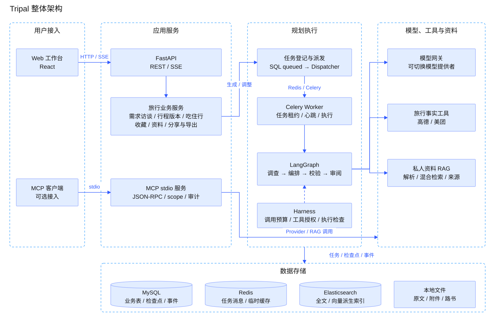
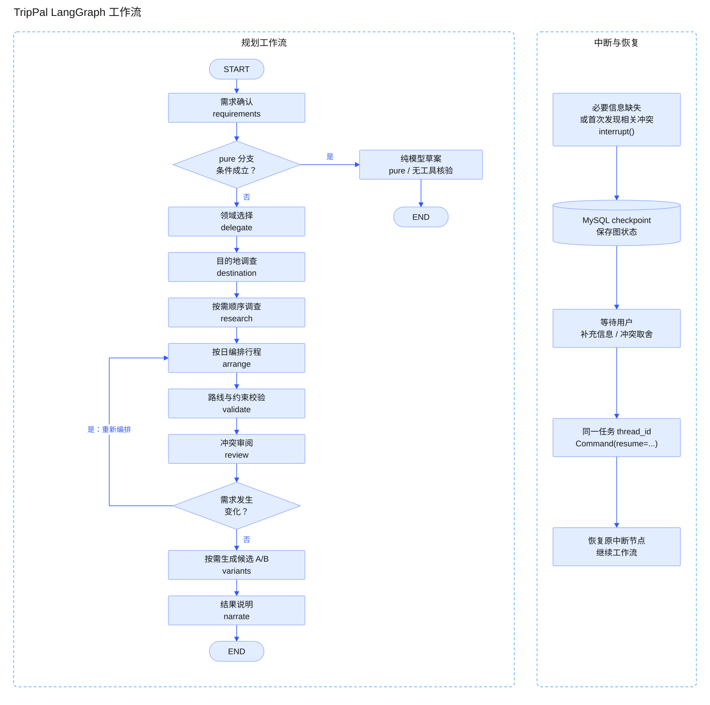

<div align="center">
  
  <p>
    
    
    
    
    
    <a href="#-license"></a>
  </p>
  <p><strong>简体中文</strong> | <a href="README.en.md">English</a></p>
</div>

**Tripal 旅伴是一款可自托管的 AI 旅行规划智能体助手，面向中国境内旅行。**
告诉它目的地、日期、预算和偏好，即可开始规划：收集必要条件，查询地点与路线，参考自己的攻略，生成可查看、可调整的每日行程。

从比较候选方案、锁定想去的地点，到安排每天的吃住行、导出旅行路书，规划与修改都在同一工作台完成。地点和路线附带来源，行程修改保留版本，缺少依据的价格、开放时间与预约信息标记为待核实。

<p align="center"><a href="docs/assets/demo/tripal-demo.webm"></a></p>


## ✨ 核心特性

| 特性 | 说明 |
|---|---|
| 💬 **对话式规划** | 从自然语言中收集目的地、日期、预算与偏好，只追问缺少的必要条件。 |
| 🧭 **方案比较与调整** | 调查候选地点、编排每日安排并校验约束；支持按需比较方案、锁定地点和继续调整。 |
| 🗺️ **地图与地点探索** | 在大地图旁浏览景点、美食和住宿；滚动加载更多候选，保留已加载结果并支持失败重试。 |
| 🍜 **每日吃住行** | 查看交通与花费、替换餐厅、分页选择住宿；保存修改时检查行程版本。 |
| 📚 **私人攻略检索** | 导入 TXT / MD / PDF / DOCX，以 BGE 向量与 Elasticsearch 混合检索查找内容，返回原文和位置。 |
| 🔎 **来源可查** | 查看地点、路线等信息的来源平台、查询时间与链接；缺失信息明确标注。 |
| 📖 **路书与导出** | 预览每日路书，分享行程，导出 PDF 或 Markdown。 |
| 🔐 **权限与执行控制** | 按用户隔离资料，以行程成员角色控制读写；通过 MCP scope、调用预算和事件记录约束工具执行。 |

## 🏗️ 系统架构

### 整体架构

React 工作台通过 REST 发起请求，通过 SSE 接收执行进度。FastAPI 处理身份认证、成员权限与旅行业务；生成和调整任务先写入 MySQL，再由派发器经 Redis / Celery 投递给 Worker。LangGraph 组织规划过程，Harness 控制调用预算、工具授权与执行检查。



[查看原图](docs/assets/architecture/structured/01-overall.svg) · [编辑 draw.io 源文件](docs/assets/architecture/structured/01-overall.drawio)

MySQL 保存任务、行程版本、检查点与事件；Redis 承担消息与临时缓存；Elasticsearch 保存可重建的检索索引。私人资料检索按用户与文档版本限制可见范围。MCP stdio 是可选工具入口，可直接调用 Provider / RAG，不要求经过规划工作流。

### LangGraph 工作流

默认流程依次完成需求确认、领域选择、目的地调查、按需研究、行程编排、路线校验与冲突审阅。领域调查按顺序执行；当需求发生变化时，回到编排节点重新安排。



## 🚀 Quickstart

### 1. 前置条件

以下命令使用 macOS / Linux 的路径写法。

- **Python 3.11**，项目要求 `>=3.11,<3.12`。
- **Node.js 22+ 与 npm**。
- **Docker 与 Compose**，启动应用前确保 Docker 正在运行。
- 真实规划需配置可用的模型服务；真实地点查询和地图展示需配置高德 Key。

### 2. 安装

```bash
git clone https://github.com/JingleiCui/TripPal.git
cd TripPal
python3.11 scripts/bootstrap.py
```

安装脚本创建 `.venv`，安装 Python 锁定依赖及 `frontend`、`integrations` 两个 npm 项目的依赖，并在 `config.local.json` 不存在时从模板创建它。后续命令均在仓库根目录执行。

### 3. 配置

初次体验可保留默认配置，在界面中显式选择合成资料。接入真实服务时，用编辑器打开已被 Git 忽略的 `config.local.json`：

| 用途 | 配置位置 |
|---|---|
| 模型规划 | 用 `active_model_profile` 选择 `model_profiles` 中的配置，在该 profile 内填写 `model_api_key`、可用的模型名称，并设 `model_enabled: true`。 |
| 地点、路线与天气 | 在文件顶层填写高德 Web 服务 Key：`amap_key`。 |
| 地图展示 | 在文件顶层填写高德 JS Key：`amap_js_key`，以及安全密钥 `amap_security_code`。 |
| 美团查询（可选） | 配置官方 CLI 凭证并开启 `meituan_enabled`，步骤见[平台配置](docs/平台申请与配置.md#5-美团酒旅推荐)。 |

修改配置后重启应用和 Worker；`TRAVEL_<SETTING_NAME>` 环境变量优先于文件配置。可先检查配置解析：

```bash
# 不调用模型 API；不会验证凭证、额度或模型的实际可用性。
.venv/bin/python scripts/check_providers.py --all-profiles
```

配置详情：[平台申请与配置](docs/平台申请与配置.md) · [模型 profile 与能力槽位](docs/模型网关与Provider切换.md)。

### 4. 运行

```bash
.venv/bin/python run_project.py
```

启动器启动 Compose 服务，等待 MySQL，执行数据库迁移与图检查点初始化，按需构建前端，然后启动 Celery Worker 和 Uvicorn。

打开[应用首页](http://127.0.0.1:8808/)，创建本地账户，进入 **新建旅行 → 使用合成资料体验**，输入：

```text
去北京玩三天，两个人，总预算3000元，喜欢历史文化，少走路，直接规划。
```

也可在 PyCharm 中选择 `.venv/bin/python`，直接运行 `run_project.py`；端口等常用配置位于文件顶部。API 文档位于 [http://127.0.0.1:8808/docs](http://127.0.0.1:8808/docs)。

| 服务 | 本地端口 |
|---|---|
| 应用 / Vite 开发服务 | `8808` / `8809` |
| MySQL / Redis / Elasticsearch | `13316` / `16389` / `19220` |
| Mailpit 测试邮箱 | `18026` |

运行 `.venv/bin/python stop_project.py` 停止应用进程。容器继续运行；如需停止本项目容器，在仓库根目录执行 `docker compose stop`。

<details>
<summary>启用私人资料检索</summary>

资料索引和检索依赖 Elasticsearch 与本地 BGE 模型。默认配置 `embedding_local_only: true` 仅加载已缓存的模型；首次使用前，在可访问模型仓库的网络中执行一次：

```bash
.venv/bin/python -c "from sentence_transformers import SentenceTransformer; SentenceTransformer('BAAI/bge-small-zh-v1.5', device='cpu')"
```

该命令下载并缓存默认向量模型。随后重启应用与 Worker，在**资料**页面上传文件，等待状态变为**已索引**后检索。更换向量模型或维度前，请检查索引配置，避免与已有索引不一致。
</details>

<details>
<summary>开发、测试与部署</summary>

保持应用与 Compose 服务运行，在另一个终端执行：

```bash
.venv/bin/python -m pytest -q
.venv/bin/ruff check backend migrations
npm run build --prefix frontend
npm run test:e2e --prefix frontend
```

前端热更新：`npm run dev --prefix frontend`，随后访问 `http://127.0.0.1:8809/`。浏览器测试使用本机 Chrome，默认访问 `8808`。

完整测试可能需要模型缓存及已配置的外部服务，具体范围见[功能与工程验证](docs/功能与工程验证.md)。服务器部署见[部署与运维](docs/部署与运维.md)。
</details>

## 📁 项目结构

```text
TripPal/
├── backend/
│   ├── travel_agent/         # FastAPI 应用与领域逻辑
│   │   ├── agent/            # LangGraph、Harness 与结构化输出
│   │   ├── models/           # 模型注册、平台适配与调用网关
│   │   ├── providers/        # 高德、美团、预订意向与合成资料
│   │   ├── mcp/              # 带 scope 与审计的 stdio 工具服务
│   │   ├── parsers/          # 订单、GPX 与截图解析
│   │   ├── knowledge.py      # 文档解析、切分与混合检索
│   │   ├── interview.py      # 需求合并与提问门控
│   │   └── worker.py         # 异步任务、租约与版本提交
│   └── tests/                # 后端单元与集成测试
├── frontend/
│   ├── src/                  # 规划对话、地图探索与每日行程界面
│   ├── public/               # 城市图片与 Logo favicon
│   └── e2e/                  # Playwright 浏览器测试
├── integrations/             # 美团官方 CLI 的 npm 依赖
├── migrations/               # Alembic 数据库迁移
├── scripts/                  # 安装、自检、录制、绘图与备份工具
├── docs/                     # 设计、配置、验证与运维文档
│   ├── architecture/         # 架构说明与图集
│   └── assets/               # Logo、演示、截图与架构图源文件
├── eval/                     # 评估样例与使用说明
├── config.example.json       # 不含凭证的本地配置模板
├── requirements.lock.txt     # Python 依赖锁定
├── compose.yaml              # 本地数据库、消息、检索与邮件服务
├── run_project.py            # 支持 IDE 直接运行的启动器
└── stop_project.py           # 停止本项目持有的应用进程
```

## 📄 License

本项目采用 **GNU Affero General Public License v3.0（AGPL-3.0）**，完整条款见 [LICENSE](LICENSE)。

