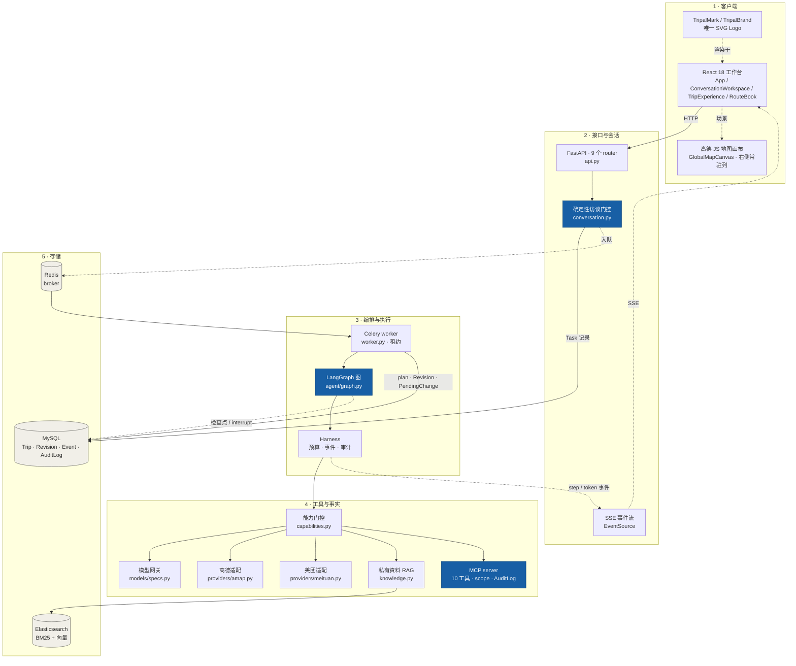
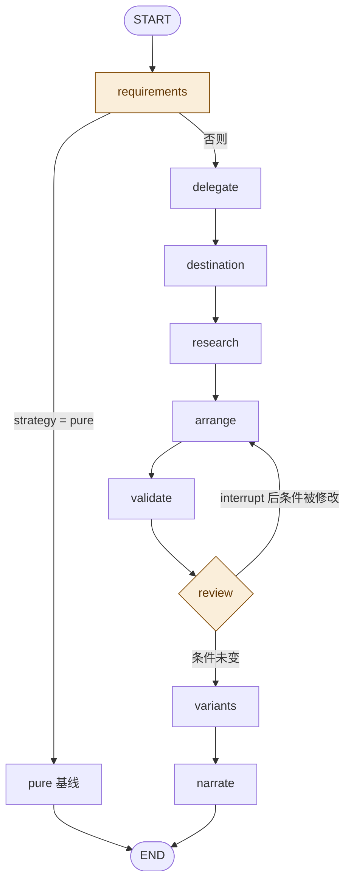
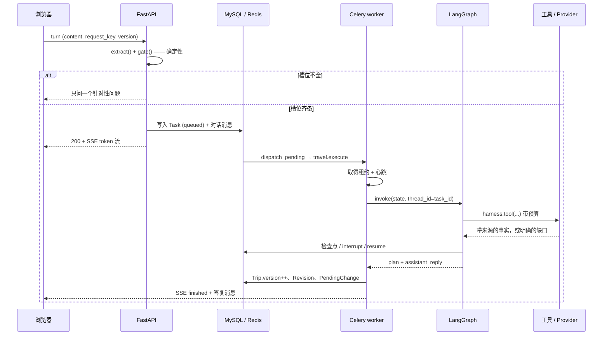
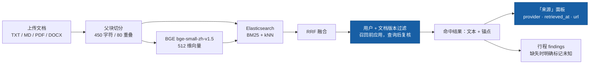

<div align="center">

# Tripal 旅伴

> **一句话，安排好下一程。** / *Say it. Plan it. Go.*

> **一个拒绝编造事实的旅行规划智能体。** 用一句话说清期待，生成的行程里每个地点、路线与价格都带来源；查不到时写「未知」，而不是猜一个。Tripal（旅伴）是产品名，`travel_agent` 是仓库与 Python 包名。

</div>

<p align="center">
  
  
  
  
  
  <a href="#-license"></a>
</p>

<p align="center">
  <strong>简体中文 · 默认</strong> · <a href="./README.md">English</a>
</p>

---

## 项目简介

`travel_agent` 是自托管的中国境内旅行规划应用。一句简短对话会被**有界的 LangGraph 监督者**
拆解为按天行程：由它分派领域智能体做调查、通过工具调用真实的地图与商业适配器、
按约束校验结果，最后写入带版本的行程。React 工作台把对话、行程与实时高德地图画布并排呈现。

两个设计决定贯穿全项目。第一，**智能体不负责路由**：收集目的地、日期与天数的访谈是代码实现的
确定性防循环门控，绝不擅自默认目的地或天数。第二，**事实不是自由文本**：工具结果只作资料、
不作指令；缺失的开放时间、价格、坐标一律保持未知。模型或高德 Web 服务凭证缺失时，系统提供
明确标注的合成流程用于演练工程链路，不会悄悄用假旅行数据顶替真实查询。

技术栈为 FastAPI + Celery + LangGraph（MySQL 检查点）、Redis 作 broker、
Elasticsearch + BGE 向量做私有资料检索、React 18 / Vite 前端。模型层是可插拔网关，内置 9 个
供应商预设（OpenRouter、百炼 Qwen 兼容模式、通用 OpenAI-compatible、硅基流动、DeepSeek、
Gemini、Ollama、百炼原生多模态、进程内本地模型），并按 chat / structured / vision / asr /
tts 能力槽位分配。

---

## 品牌

| | |
|---|---|
| **产品名** | **Tripal**（英文）· **旅伴**（中文）——*trip* + *pal*：陪你把行程安排好的 AI 旅行规划助手 |
| **Slogan** | **一句话，安排好下一程。** / *Say it. Plan it. Go.* |
| **定位** | **AI 旅行规划智能体**，不是旅游找搭子 / 交友 App——一句话说的是行程，智能体产出的是计划 |
| **吉祥物 / Logo** | Jellycat 风格毛绒行李箱：方中带软的箱体、刺绣五官，头顶**黄色四角星光**（`#FFCE73`）。星光必须是黄色，不使用薄荷绿 |
| **配色** | 奶油 `#FFF7F1` · 珊瑚 `#FF8A6B` · 深珊瑚 `#EA6E4E` · 薄荷 `#5FC9AC` · 奶油黄 `#FFCE73` · 墨色 `#3B3432` |
| **字体** | Outfit + Noto Sans SC |

唯一官方 Logo 是 React SVG 组件
[`frontend/src/components/TripalLogo.tsx`](./frontend/src/components/TripalLogo.tsx)
（`TripalMark` 与 `TripalBrand`）。全站每处 Logo——页眉、加载态、助手头像、路书封面，以及下载的
HTML 兜底文件——都由这个组件渲染，因此箱体造型、居中五官与黄色星光不会各自跑偏。品牌常量见
[`frontend/src/brand.ts`](./frontend/src/brand.ts)，视觉覆盖层见
[`frontend/src/tripal.css`](./frontend/src/tripal.css)。可编辑设计源是 Ardot 文件
`748410942732274`（*Tripal 旅伴 · 品牌与界面视觉升级 v2*）；它是设计工具文件，不是已提交的图片。

---

## 首屏运行证据

> **需补充素材**：仓库目前没有录制好的 Demo GIF 与界面截图（`git ls-files` 中被跟踪的图片
> 只有 `frontend/public/images/` 下 4 张装饰性城市照片）。Logo 已按上文实现为 `TripalMark`
> SVG 组件，但仓库里仍没有独立的 logo 图片文件。下面没有编造任何图片或视频链接。
> 在补录之前，这一节给出**真实可复现**的首屏证据：受治理的 MCP server 通过 stdio 暴露的
> 10 个工具，以及产生它们的命令。

一条命令启动受治理的 MCP server；发送 `initialize` 与 `tools/list` 即可得到带 scope 的工具面：

```bash
PYTHONPATH=backend .venv/bin/python -m travel_agent.mcp.server
```

```text
→ initialize   protocolVersion 2024-11-05 · serverInfo travel-agent-mcp 0.1.0
→ tools/list   10 个工具，每个都标注 travel_agent:<能力> scope
   amap_search_places    travel_agent:maps        amap_poi_detail     travel_agent:maps
   amap_route            travel_agent:maps        amap_distance_matrix travel_agent:maps
   amap_traffic_route    travel_agent:maps        amap_weather        travel_agent:weather
   meituan_query         travel_agent:meituan     meituan_food        travel_agent:dining
   knowledge_search      travel_agent:knowledge   booking_intent      travel_agent:lodging
→ 每次 tools/call 都先校验授予的 scope，再写一条 AuditLog（actor=mcp）
```

同样的治理也作用在智能体内部：单个任务会写出追加式 `Event` 轨迹
（`step` / `model_start` / `model_end` / `tool_start` / `tool_end` / `assistant_token` /
`variant_ready` / `finished`），前端通过 SSE 消费。一次有代表性的执行：

```text
  ● POST /api/v1/conversations/{id}/turns   → 确定性门控：目的地 / 日期 / 天数
  ● Task 入队 → Celery 取得租约 → 从 MySQL 检查点恢复 LangGraph
  ● step  需求确认 → 主 Agent 安排调查 → 目的地调查
  ● tool_start  amap_places → tool_end  success
  ● step  安排每日行程 → 查询实际路线并检查约束
  ● assistant_token × N  → SSE 流式推送到对话
  ✓ finished  status=completed · 写入 Revision + PendingChange
```

---

## ✨ 特性

> 便于 F 型扫读。下表每一行都能在仓库中找到对应实现与测试。

| | 能力 | 已实现内容 |
|---|---|---|
| 🧭 | 确定性访谈 | 规则槽位提取（城市、天数、「下周三-下周五」等相对日期、预算、兴趣）与结构化模型提取合并；代码驱动的防循环门控每次只问一个问题，不默认目的地与天数 |
| 🕸️ | 有界 LangGraph | 监督者 + 领域智能体，链路为 `requirements → delegate → destination → research → arrange → validate → review → variants → narrate`；缺日期与约束取舍用持久 `interrupt()`；MySQL 检查点 + `Command(resume=...)` |
| 🔒 | 执行护栏 | 单任务模型调用上限 12、工具调用上限 24、时间预算 600 秒，租约 + 心跳、行程乐观锁、追加式 `Event` 审计、按能力收敛可见工具 |
| 🛰️ | 受治理 MCP server | 自实现 JSON-RPC over stdio：`initialize` / `ping` / `tools/list` / `tools/call`，10 个工具，逐工具 `travel_agent:<能力>` scope 校验，每次调用写 `AuditLog` |
| 🗺️ | 真实空间事实 | 高德 Web 服务适配：POI 检索与详情、步行/公交/驾车路线、距离矩阵、实时交通路线、天气、地理编码；保留 GCJ-02；前端高德 JS 画布呈现图钉与路线 |
| 🍜 | 美食与商业 | 高德 POI 美食检索（过滤非餐饮主体），美团 CLI 适配美食推荐、团购、酒旅/门票/交通查询；未配置时降级为空结果，绝不编造价格 |
| 📚 | 私有资料 RAG | TXT / MD / PDF / DOCX 解析、450/80 字符父子切块、BGE `bge-small-zh-v1.5` 512 维向量、Elasticsearch BM25 + kNN 混合检索与 RRF 融合、召回前按用户与文档版本过滤、查询后复核可见性 |
| 🔍 | 来源可溯 | 每个地点带 `source.provider` / `retrieved_at` / `url`；独立的「来源」面板列出每项事实出处；行程保留 `verification`、`warnings` 与未知费用项 |
| 🧩 | 智能体能力层 | 能力门控把 `maps / weather / dining / meituan / lodging / knowledge` 映射到工具集；逐变更**撤销窗口**卡片（15 分钟）基于 `Revision` 回退；订单 / GPX / 截图附件驱动建议；预订只生成结构化**意图**，不执行支付 |
| 🧠 | 可插拔模型网关 | 9 个内置供应商预设 + 自定义 `model_providers`；按 `chat / structured / vision / asr / tts` 槽位分配；结构化输出用 `json_schema` 或 `function_calling`，只允许**一次**有界纠正，没有编造兜底 |
| 👥 | 账户与协作 | 注册、密码哈希、持久会话、CSRF、可撤销 JWT、按用户隔离、owner/editor/viewer 成员、只读分享、PDF/Markdown 导出、隐私导出与账户注销 |
| 🎨 | Tripal 品牌系统 | 唯一 SVG Logo 组件复用于页眉、加载态与助手头像；奶油/珊瑚/薄荷/奶油黄配色通过最后引入的 CSS 覆盖层生效，旧样式无法把上一版品牌带回来 |
| 📖 | 路书页 | `/trips/:id/routebook` 左侧为每日卡片、右侧为大幅插画路线图；**每天的天气与已知花费放在当天块内**，有高德预报时用真实数据，查不到则明确标注待核实 |
| 🗺️ | 地图优先工作台 | 高德画布是默认可见、处于文档流中的右侧列（不是浮层），左侧的地点详情卡与经典信息卡都不会被盖住；收起后页面回到单栏 |
| 📄 | 路书下载 | 导出走 `fetch` + Blob 并校验 PDF 文件头；PDF 生成失败时改为下载自包含、可打印的 HTML 路书，而不是点了没反应 |
| ✅ | 已验证工程 | 25 个后端测试模块（153 个测试函数）、6 个 Playwright spec、前端 `tsc --noEmit` 与 Vite 构建、依赖与平台自检脚本 |

---

## 🏗️ 架构图

以下 4 张图均使用 GitHub 可渲染的 Mermaid；分层、配色、连线语义与源码对照清单见
[`docs/README架构图呈现方案.md`](./docs/README架构图呈现方案.md)。

### A. 系统分层



### B. LangGraph 控制流

节点从 `START` 起线性连接；两条条件边是唯二的分支，一条回边是唯一的循环。



终止由代码而非模型约束：`recursion_limit=30`、每个领域智能体最多 3 轮工具调用、
结构化输出最多 2 次尝试，外加 harness 预算与租约检查。`requirements` 与 `review` 的
`interrupt()` 会把任务置为 `waiting_input`，再从 MySQL 检查点恢复。

### C. 一次任务的端到端时序



---

## 🚀 Quickstart

以下命令均为仓库实际使用的命令，已在 macOS + Python 3.11.7 + Docker Desktop + Node.js/npm
上核对。

### 前置条件

| 依赖 | 说明 |
|---|---|
| Python **3.11** | `pyproject.toml` 固定 `>=3.11,<3.12`；`scripts/bootstrap.py` 会拒绝其他版本 |
| Docker Desktop | `run_project.py` 执行 `docker compose up -d`，启动 MySQL 8.4、Redis 7.4、Elasticsearch 8.17.4、Mailpit |
| Node.js + npm | 为 `frontend/` 与 `integrations/` 执行 `npm ci`；两个 lock 文件均已提交 |
| 高德 Web 服务 Key + JS Key | 真实 POI/路线/天气查询与地图瓦片所需，见 [`docs/平台申请与配置.md`](./docs/平台申请与配置.md) |
| 模型凭证 | 真实规划所需。没有凭证时可使用明确标注的合成流程 |

### 安装

```bash
git clone https://github.com/JingleiCui/travel_agent.git
cd travel_agent
python3.11 scripts/bootstrap.py
```

`bootstrap.py` 会创建 `.venv`、安装 `requirements.lock.txt`、以 `pip install -e . --no-deps`
安装本包、在 `frontend/` 与 `integrations/` 执行 `npm ci`，并在文件不存在时从
`config.example.json` 生成 `config.local.json`（权限 `0600`）。

### 配置

```bash
cp config.example.json config.local.json   # bootstrap 已自动生成则可跳过
$EDITOR config.local.json
```

示例配置自带 `model_enabled: false` 与 `fixture_enabled: true`，因此无需任何凭证也能启动。
要启用真实规划，请为所选 profile 填写 `model_api_key` 并置 `model_enabled: true`，同时填
`amap_key` / `amap_js_key`。配置 profile、供应商预设、槽位分配与凭证隔离规则见
[`docs/模型网关与Provider切换.md`](./docs/模型网关与Provider切换.md)。配置在进程启动时加载，
修改后需重启服务；`TRAVEL_<配置项大写>` 环境变量可覆盖文件值。

```bash
.venv/bin/python scripts/check_providers.py --all-profiles   # 只查配置，不联网
```

### 运行

```bash
.venv/bin/python run_project.py
```

启动器等待 MySQL 就绪、执行 Alembic 迁移、初始化 LangGraph MySQL 检查点、在源码有变更时
构建前端，然后启动 Celery worker 与 Uvicorn。打开 <http://127.0.0.1:8808/> 注册本机账户。
API 文档：<http://127.0.0.1:8808/docs>。

端口：API `8808`，Vite 开发 `8809`，MySQL `13316`，Redis `16389`，Elasticsearch `19220`，
本机 Mailpit 收件箱 `18026`。用 `stop_project.py` 或 Ctrl+C 停止；数据库卷保留数据。

### 验证

```bash
curl -s http://127.0.0.1:8808/api/v1/health
.venv/bin/python -m pytest -q
.venv/bin/ruff check backend migrations
npm run build --prefix frontend
npm run test:e2e --prefix frontend
PYTHONPATH=backend .venv/bin/python -m travel_agent.mcp.server   # 从 stdin 发送 tools/list
```

其中 2 个用例依赖**真实** Elasticsearch，需要上述容器处于运行状态；服务齐全时后端套件全部
通过。本机验收记录及其适用范围见 [`docs/验收结果.md`](./docs/验收结果.md)。

---

## 📁 项目结构

```text
travel_agent/
├── backend/
│   └── travel_agent/
│       ├── api.py                 # FastAPI app、health、9 个 router
│       ├── conversation.py        # 确定性槽位提取 + 防循环门控
│       ├── social_api.py          # 对话轮次、SSE 事件、方案选择
│       ├── schemas.py             # Requirements / PlanSelection / RunRequest
│       ├── planning.py            # 行程组装、约束校验、diff
│       ├── worker.py              # Celery 任务、租约、Revision、PendingChange
│       ├── db.py                  # SQLAlchemy 模型，含 Event / AuditLog
│       ├── knowledge.py           # 切块、BGE 向量、ES 混合检索、RRF
│       ├── capabilities.py        # 能力 → 工具集门控
│       ├── agent/
│       │   ├── graph.py           # LangGraph 节点、边、interrupt
│       │   ├── harness.py         # 模型/工具预算、事件、租约检查
│       │   └── structured.py      # 结构化输出 + 一次有界纠正
│       ├── models/                # 供应商预设、registry、网关
│       ├── providers/             # amap、meituan、booking、fixtures
│       ├── mcp/server.py          # 受治理 MCP server（10 工具、scope、审计）
│       ├── parsers/               # GPX、订单文本、截图
│       ├── adapters/              # 外部 MCP 桥接骨架
│       └── *_api.py               # discovery / bookings / services / budget / hotel / …
│   └── tests/                     # 25 个 pytest 模块
├── frontend/
│   ├── src/
│   │   ├── App.tsx                # 路由、应用外壳、规划工作台
│   │   ├── RouteBook.tsx          # /trips/:id/routebook 路书页
│   │   ├── TripExperience.tsx     # 每日行程 + 天气/花费上下文条
│   │   ├── MapPanel.tsx           # 把地图场景发布到共享 store
│   │   ├── components/
│   │   │   ├── TripalLogo.tsx     # 唯一 TripalMark / TripalBrand SVG
│   │   │   ├── AppHeader.tsx      # 品牌页眉
│   │   │   └── GlobalMapCanvas.tsx # 右侧文档流中的高德画布
│   │   ├── lib/
│   │   │   ├── mapScene.ts        # 共享地图场景 store
│   │   │   └── routeBookHtml.ts   # 可打印 HTML 导出兜底
│   │   ├── brand.ts               # 产品名 / slogan 常量
│   │   ├── tripal.css             # 品牌视觉覆盖层
│   │   └── map-first.css          # 左内容 + 右地图两栏布局
│   ├── e2e/                       # 6 个 Playwright spec
│   └── public/images/             # 装饰性城市照片（已被跟踪）
├── migrations/                    # Alembic 迁移
├── scripts/                       # 首次安装、Provider 自检、冒烟、备份、评测
├── eval/                          # 标注案例与评测说明
├── docs/                          # 架构、配置、验收、上游归属声明
│   └── upstream/                  # Atlas / JourneyPilot 许可证与声明
├── integrations/                  # 官方美团 CLI（npm）
├── compose.yaml                   # 本机服务栈
├── run_project.py                 # 一键启动器
├── stop_project.py                # 限定范围的停止脚本
├── config.example.json            # 安全的配置模板
└── requirements.lock.txt          # 锁定的 Python 依赖
```

`config.local.json`、`.venv/`、`data/`、`reports/` 与构建产物均被 `.gitignore` 排除。

---

## 🧪 效果与证据

> **需补充截图**：仓库尚未提交任何界面截图或检索溯源截图——`reports/` 下有本机采集的截图，
> 但被 `.gitignore` 排除；4 张已跟踪的 `frontend/public/images/*.jpg` 是装饰照片，不是证据。
> 因此下面以可复现的命令与已记录观测呈现，不冒充图片。发布前建议把「来源」面板截图
> （显示 `provider · retrieved_at · url`）补到 `docs/assets/`。
> 品牌与界面 QA 环节补充了路书下载、珊瑚页眉上的 Logo 底托、地图右栏不遮挡卡片等浏览器核验；
> 这些本机截图同样未提交，不在 README 中链接。

### 后端可核对的结论

| 检查 | 结果 | 位置 |
|---|---|---|
| 后端测试 | 收集 158 项，本机 156 项通过；其余 2 项依赖运行中的 Elasticsearch，容器未启动时报 `Connection refused` | `backend/tests/`、`.venv/bin/python -m pytest -q` |
| 前端 | `tsc --noEmit` 与 `vite build` 通过 | `frontend/package.json` |
| 浏览器 | 桌面、移动端、刷新恢复，以及对话对比、多城市用例 | `frontend/e2e/`、`docs/验收结果.md` |
| 路书导出 | PDF 接口返回 `%PDF`；浏览器下载得到 `travel-roadbook.pdf`；拦截该接口时改为下载自包含的 `travel-roadbook.html` 兜底 | `frontend/src/api.ts`、`backend/tests/test_api.py::test_exports_are_real_pdf_and_text` |
| 品牌与布局 QA | 统一 Logo 星光为黄色，在珊瑚页眉的奶油底托上清晰可辨；地图默认显示在独立右栏，地点详情卡始终在上层 | `frontend/src/components/TripalLogo.tsx`、`frontend/src/map-first.css` |
| 文档检索 | 真实 BGE 编码、ES 召回、两用户隔离、旧版本不可见、删除后不可见 | `docs/验收结果.md` |
| 工程回归 | 60/60 合成状态匹配——无模型的工程校验，不是质量基准 | `reports/regression-*.json` |
| 模型冒烟 | 本机 Ollama `qwen3:4b-instruct` 完成纯模型 / 单 Agent / 按需多 Agent 各一例；后续一次运行也如实保留两次失败，未补成成功 | `reports/local-model-smoke-*.json` |
| 备份 | MySQL 与原文恢复到独立库，哈希一致 | `reports/restore.log` |

以上数字是带原始口径的单次本机观测，确切适用范围见
[`docs/验收结果.md`](./docs/验收结果.md)：不主张 P95 延迟、生产成功率或用户满意度。

### RAG：检索溯源链路



关键区别在于：检索命中是**支撑资料**，不是指令。若某个分块回答不了问题，对应行程字段就保持
未知，智能体不会把猜测的价格或开放时间升格为已确认事实。高德与美团的工具输出同样遵循此规则。

### 关于合成流程

无凭证时，`fixture_enabled: true` 提供一条明确标注的合成轨道，用固定夹具跑完整工程链路——
任务状态、图流程、版本、检索与恢复。它用于理解系统，不能用于真实出游，也绝不会被悄悄用来
替代真实查询。

---

## 📄 License

本仓库**尚无根 `LICENSE` 文件**，因此不对项目整体主张任何许可证。此处如实说明，不做猜测；
发布前需要决定的事项见下方「发布前需补充的素材与信息」。

随项目分发的上游代码保留各自声明：改编自 **Atlas** 的确定性访谈与信号辅助函数
（MIT，Copyright 2026 Dejan Žegarac）记录在
[`docs/upstream/Atlas-NOTICE.md`](./docs/upstream/Atlas-NOTICE.md)，完整许可文本见
[`docs/upstream/Atlas-LICENSE`](./docs/upstream/Atlas-LICENSE)；JourneyPilot 固定参考提交及
许可见 [`docs/upstream/NOTICE.md`](./docs/upstream/NOTICE.md) 与
[`docs/upstream/JourneyPilot-LICENSE`](./docs/upstream/JourneyPilot-LICENSE)。再分发这些文件时
须一并保留上述声明。

---

<details>
<summary><b>发布前需补充的素材与信息</b></summary>

上面的 README 没有编造任何 URL、截图、命令或许可条款。发布前需由维护者补齐：

1. **Demo GIF / 短视频**——首屏「一句话到行程」的录屏（`## 首屏运行证据` 即其占位处），
   建议放 `docs/assets/demo.gif`。
2. **独立 Logo 图片**——Logo 已实现为唯一的 `TripalMark` SVG 组件并在全站使用，但仓库里没有
   独立的图片资源供 GitHub 页首使用，也没有 `<picture>` 明暗双版本。需要图片时可从组件或
   Ardot 设计文件导出一份。
3. **界面截图**——对话工作台、带右侧高德列的行程画布、路书页、探索页网格、撤销窗口卡片。
   现有本机采集（含品牌 QA 轮次）在 `reports/` 或 `/tmp`，均被 git-ignore。
4. **检索溯源截图**——RAG 行程的「来源」面板，显示 `provider · retrieved_at · url`，
   为 `🧪 效果与证据` 一节所需。
5. **根 `LICENSE`**——选定并添加许可证后，替换占位许可证 badge 与 `📄 License` 章节。
6. **精确的 Node.js 版本**——仓库固定了 Python 3.11，但未声明 Node 版本；补充 `.nvmrc` 或
   `engines` 可让 Quickstart 完全确定。
7. **仓库元数据**——description、topics、社交预览图（可选）。

仅当真实凭证可用时才可选补充：真实高德查询、美团卡片、真实模型运行的截图。
`docs/验收结果.md` 已记录哪些已验证、哪些未验证；未验证项不得表述为通过。

</details>
