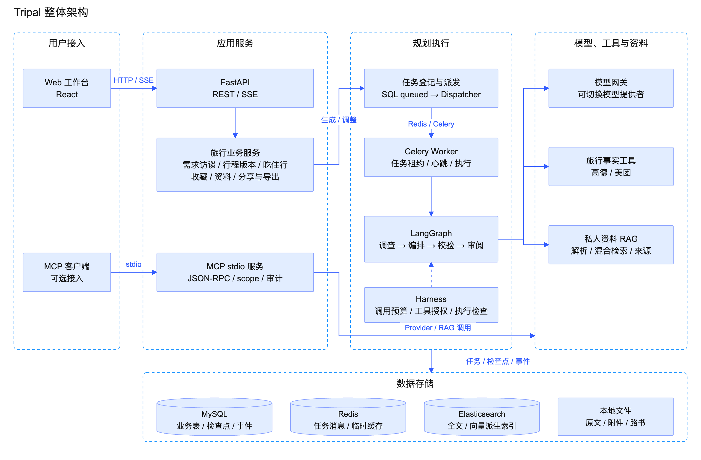
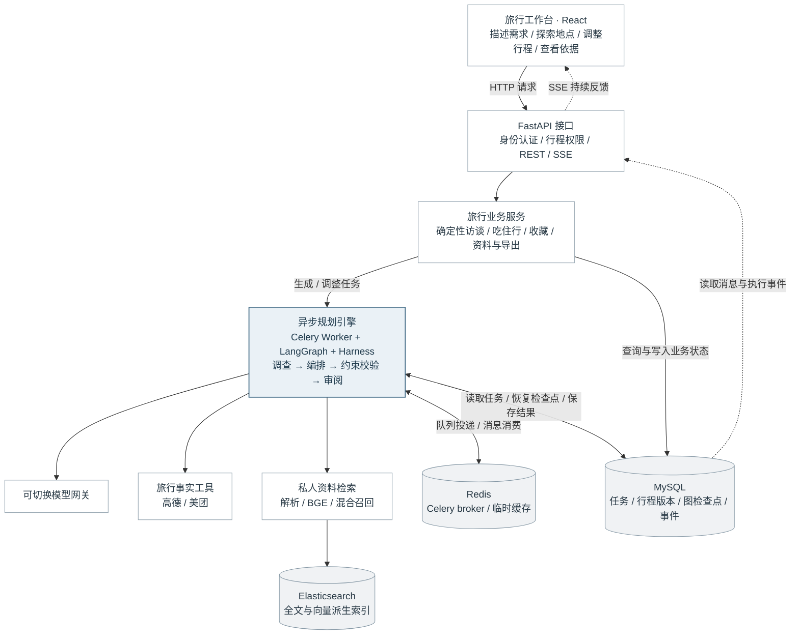
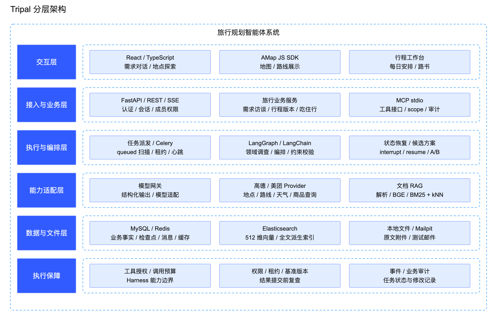
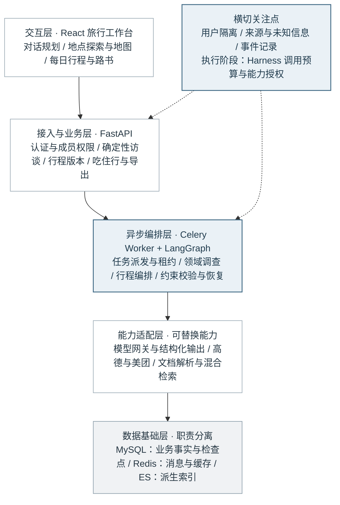
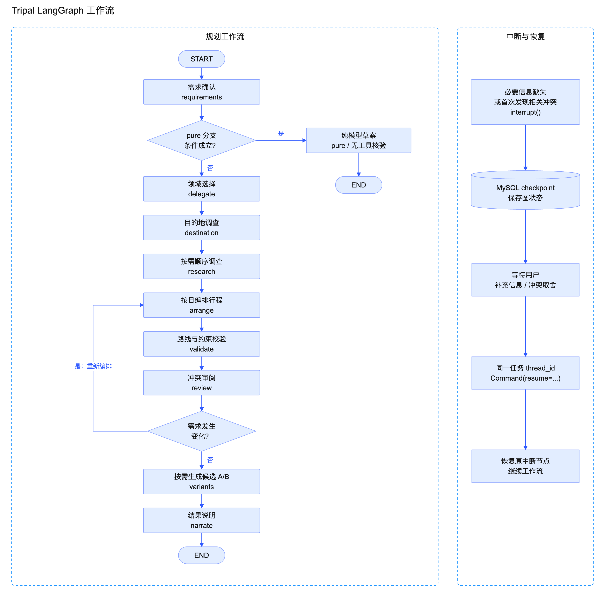
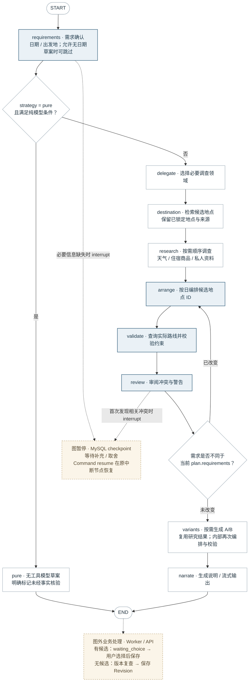
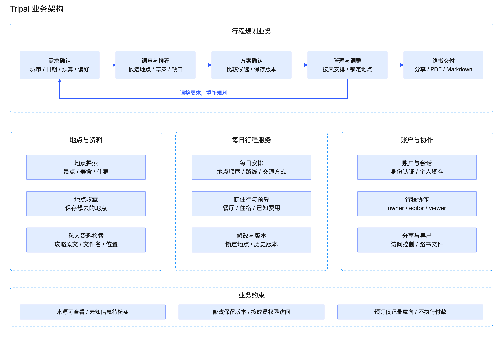
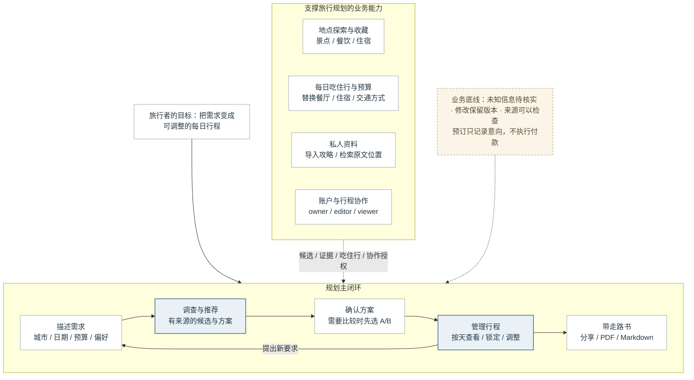
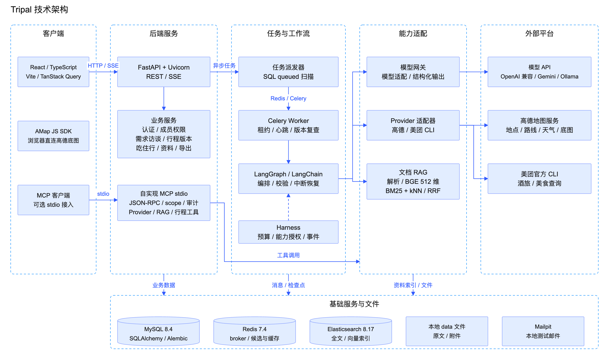
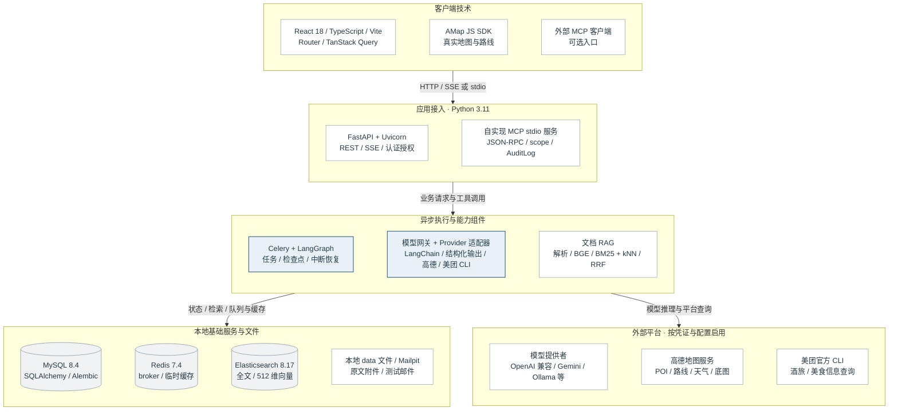

# Tripal 架构图选集

五张图依据 2026-11-18 当前代码绘制，参照课程文档中的工程架构图与流程图表达：虚线表示分区边界，浅蓝矩形表示模块，蓝色箭头表示调用或流转关系；工作流使用菱形判断和起止节点。分层图采用左侧层名与右侧模块矩阵。

[打开可缩放选图页](index.html)。每张图均提供可编辑的 draw.io 源文件、SVG 和 2 倍分辨率 PNG。旧版 Mermaid 仅保留为逻辑参考，不对应新版的固定布局。

| 编号 | 图 | 回答的问题 | 建议用途 |
|---|---|---|---|
| 01 | [整体架构](../../docs/assets/architecture/structured/01-overall.png) | 回答系统由哪些部分组成，以及一次规划如何形成反馈闭环。 | 适合 README 的第一张架构图。 |
| 02 | [分层架构](../../docs/assets/architecture/structured/02-layered.png) | 按职责划分交互、业务、编排、适配和数据层，突出模块边界。 | 适合工程设计说明；与整体图可二选一。 |
| 03 | [LangGraph 工作流](../../docs/assets/architecture/structured/03-langgraph.png) | 逐一对应实际节点、纯模型分支、约束回路和持久化中断。 | 适合突出 Agent 实现，与整体图搭配。 |
| 04 | [业务架构](../../docs/assets/architecture/structured/04-business.png) | 从需求、推荐、确认、调整到导出，说明产品闭环与支撑能力。 | 适合 README 项目简介之后。 |
| 05 | [技术架构](../../docs/assets/architecture/structured/05-technical.png) | 列出客户端、Python 服务、执行组件、基础服务和外部平台的技术组合。 | 适合技术栈说明，或与分层图二选一。 |

## README 已采用的图

- 当前中英文 README：**01 整体架构 + 03 LangGraph 工作流**。
- 面向使用者：**04 业务架构 + 01 整体架构**。
- 面向技术面试或设计评审：**02 分层架构 + 03 工作流 + 05 技术架构**。

README 已采用 01 与 03，英文版使用对应的英文标注图。其余三种视角保留在本图集中，供设计说明或技术交流引用。draw.io 源文件可在 diagrams.net 或 draw.io 桌面版打开，编辑模块、文字、连接点与折线。

## 绘图与导出

布局源码：[draw_architecture.py](../../scripts/draw_architecture.py)。颜色、字体、输出目录与英文图导出开关位于文件顶部 `CONFIG`，各图坐标与文案在对应绘图段落中编辑。运行后生成五种视角的 SVG 与未压缩 draw.io XML，以及供英文 README 使用的 01、03 英文版；随后可导出 PNG。所有图形均为原生节点和连接线，无需 Mermaid 或生成图片服务。

```bash
# 在项目根目录运行；Python 脚本仅依赖标准库
python3 scripts/draw_architecture.py

# 需先安装前端依赖与本机 Chrome；导出 2 倍 PNG 并检查文字边界
npm --prefix frontend ci
node scripts/export_architecture.mjs
```

draw.io 文件保留可编辑的模块、判断节点、存储符号与连接线。SVG 可直接用于 GitHub README；PNG 用于文档、演示或其他不支持 SVG 的场景。生成结果位于 `docs/assets/architecture/structured/`。

## 参考文档的借鉴方式

阅读了用户提供课程大纲的第 7、8、12、13 页，并渲染查看第 12 页。
介绍顺序借鉴“业务问题 → 能力拆解 → 技术模块 → 执行闭环”；绘图直接参考第 12 页“草本通 / SmartCloud”和第 13 页系统架构：虚线系统边界、浅蓝模块、居中文字、蓝色调用箭头，以及矩形处理、菱形判断和起止节点。去掉上一版大标题说明、卡片式排版和大段旁注。
没有把课程示例项目的能力移植成 Tripal 的功能声明：当前图不宣称已实现 A2A、Saga、Neo4j、Milvus、LangFuse 或容器化工具沙箱。

## 读图边界

- 整体图抽象了派发细节：SQL 是 queued 任务与版本的权威，派发器经 Redis/Celery 投递，Worker 执行。
- 分层图表达核心规划路径与职责边界；同步地点查询、收藏等业务可直接访问适配器或数据层。
- 技术图按技术分区聚合依赖，不是每次调用的时序。MCP stdio 可直接调用适配器/RAG，不要求经过 Celery 或 LangGraph。
- MySQL 检查点用于恢复图状态，不能代替最终行程保存时的权限、租约与基准版本复查。
- `research` 内领域按顺序执行；`single` 策略会合并调查工具。没有画成并行 fan-out。
- 工作流主干自上而下，中断恢复机制在右侧作为独立子流程；两个 `END` 表示同一结束节点，避免长距离回线。恢复使用同一任务 thread_id 与 `Command(resume=...)`，回到各自中断节点。
- `variants` 内部可再次调用编排与校验；不是另起一套调查流程。A/B 不同方案不保证总能生成。
- `END` 后，有候选时进入 `waiting_choice`，由业务 API 在用户选择后保存；无候选时 Worker 复查并保存版本。
- 纯模型基线没有外部事实核验；预订工具只记录意向，不代表下单或付款。

## 五张图与源码

### 01 · 整体架构

回答系统由哪些部分组成，以及一次规划如何形成反馈闭环。



[SVG](../assets/architecture/structured/01-overall.svg) · [PNG](../assets/architecture/structured/01-overall.png) · [可编辑 draw.io](../assets/architecture/structured/01-overall.drawio) · [旧版 Mermaid 逻辑参考](diagrams/01-overall.mmd) · [English SVG](../assets/architecture/structured/01-overall.en.svg) · [English draw.io](../assets/architecture/structured/01-overall.en.drawio)

核对入口：`api.py / social_api.py / worker.py / agent/graph.py`。

<details>
<summary>展开旧版 Mermaid 逻辑参考（布局与新版不同）</summary>



</details>

### 02 · 分层架构

按职责划分交互、业务、编排、适配和数据层，突出模块边界。



[SVG](../assets/architecture/structured/02-layered.svg) · [PNG](../assets/architecture/structured/02-layered.png) · [可编辑 draw.io](../assets/architecture/structured/02-layered.drawio) · [旧版 Mermaid 逻辑参考](diagrams/02-layered.mmd)

核对入口：`frontend/src / *_api.py / agent / providers / knowledge.py`。

<details>
<summary>展开旧版 Mermaid 逻辑参考（布局与新版不同）</summary>



</details>

### 03 · LangGraph 工作流

逐一对应实际节点、纯模型分支、约束回路和持久化中断。



[SVG](../assets/architecture/structured/03-langgraph.svg) · [PNG](../assets/architecture/structured/03-langgraph.png) · [可编辑 draw.io](../assets/architecture/structured/03-langgraph.drawio) · [旧版 Mermaid 逻辑参考](diagrams/03-langgraph.mmd) · [English SVG](../assets/architecture/structured/03-langgraph.en.svg) · [English draw.io](../assets/architecture/structured/03-langgraph.en.drawio)

核对入口：`agent/graph.py:build_graph / worker.py:execute / social_api.py:choose_variant`。

<details>
<summary>展开旧版 Mermaid 逻辑参考（布局与新版不同）</summary>



</details>

### 04 · 业务架构

从需求、推荐、确认、调整到导出，说明产品闭环与支撑能力。



[SVG](../assets/architecture/structured/04-business.svg) · [PNG](../assets/architecture/structured/04-business.png) · [可编辑 draw.io](../assets/architecture/structured/04-business.drawio) · [旧版 Mermaid 逻辑参考](diagrams/04-business.mmd)

核对入口：`conversation.py / discovery_api.py / services_api.py / social_api.py / exports.py`。

<details>
<summary>展开旧版 Mermaid 逻辑参考（布局与新版不同）</summary>



</details>

### 05 · 技术架构

列出客户端、Python 服务、执行组件、基础服务和外部平台的技术组合。



[SVG](../assets/architecture/structured/05-technical.svg) · [PNG](../assets/architecture/structured/05-technical.png) · [可编辑 draw.io](../assets/architecture/structured/05-technical.drawio) · [旧版 Mermaid 逻辑参考](diagrams/05-technical.mmd)

核对入口：`compose.yaml / requirements.lock.txt / frontend/package.json / models / mcp/server.py`。

<details>
<summary>展开旧版 Mermaid 逻辑参考（布局与新版不同）</summary>



</details>

## 重新渲染

```bash
# 仅安装到被忽略的 reports 目录，不改应用依赖。
npm install --prefix reports/architecture-tools --no-save --package-lock=false --ignore-scripts mermaid@11
node scripts/render_architecture.mjs
```

输出位置、渲染比例与浏览器配置在脚本顶部 `CONFIG`。源码在 `docs/architecture/diagrams/`，输出在 `docs/assets/architecture/structured/`。
GitHub 使用 Mermaid 代码块时采用自身主题；SVG/PNG 保留本次导出样式。图均已解析并导出，不需要联网查看图片或选图页。
