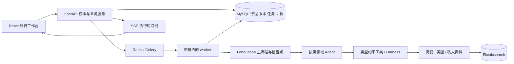
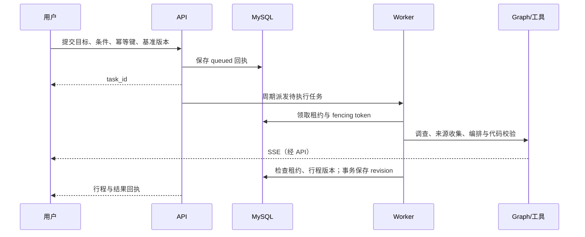

# 架构与设计取舍

## 业务论点

生成一段好看的攻略不等于完成旅行规划。这个系统的核心对象是“可持续修改、保留证据与未知条件的行程版本”，而不是一条聊天回复。

## 状态与数据归属

- MySQL 是业务状态权威；Redis 消息丢失时，SQL 中 queued 任务仍可重新派发。
- Graph 检查点保存节点状态；不能替代最终业务事务和版本检查。
- ES 是派生索引；原文和 MySQL 文档版本仍是来源权威。
- 一个任务一个 thread_id，权限来自登录会话，绝不让模型传 owner 来扩大访问范围。
- 每次修改生成新 revision；恢复旧版也新建版本，保留历史。

## 为什么要 Agent，哪些不交给 Agent

开放需求需要决定调查范围和权衡候选地点，因此使用模型；距离、金额、版本、权限与时间窗口交给代码。简单任务保留直接工具路径，不用多 Agent 数量证明复杂度。

主 Agent 是领域选择器，子 Agent 是拥有有限工具集的调查员。目前领域按顺序执行，避免本机模型与账号配额同时承压；“多 Agent”不等于“已实现并行执行”或“更快”。路线查询在候选选择后完成。

## 工具与上下文

输入通过 LangChain/Pydantic 校验，平台输出归一化。只读临时故障最多两次重试；参数修正和模型轮次有上限。工具失败不会返回猜测的“默认正确值”。Trace 分别保存开始、结束、耗时、错误与返回结果。

上下文采用结构化目标、约束、偏好、待办和旧版地点，避免完整历史无限增长。这里采用确定性的裁剪和结构摘要，并未实现能够保证二十轮语义不丢失的长期记忆系统。私人文档内容按任务检索，不自动写入永久个人偏好。

## 行程与约束边界

模型只能选择工具已返回的地点 ID；重复、排除和遗漏锁定地点由代码拒绝。锁定的日期与开始时间需要保持，冲突不能静默覆盖。停留 90 分钟是计划值，不是平台事实。预算只汇总可信数值，缺项保持未知；路线步行不包含景区内部步行。

未实现票务库存锁定、自动付款、全局旅行商最优解、山野风险判断。它们不能通过多写一个 Prompt 得到保证。

## 检索与更新

文档保留段落／页码／表格定位，按字符窗口切分（450 字符、80 重叠，不是 token）。BGE small zh v1.5 归一化 512 维；ES 全文和 kNN 各取 8，RRF 常数 60，融合最多 8，默认返回 5。重排是可选能力，需单独比较后开启。

新版本先完成索引再切换 MySQL 可见版本；失败保留旧版。检索前过滤 owner 和有效 revision，返回前再次检查可见性。删除先撤销可见性，再清理派生索引。默认不缓存私人检索结果，避免错误的权限／版本缓存键。

## 技术挑战与证据入口

| 问题 | 实现 | 验证 |
|---|---|---|
| worker 重放导致重复行程 | SQL 任务回执、状态门禁和版本事务 | replay／版本冲突用例 |
| 崩溃后旧 worker 继续提交 | 租约、心跳、token、提交前复查 | 租约失效与接管测试 |
| 改行程破坏确定安排 | 锁定约束与新 revision | 锁定、日期与时间冲突测试 |
| 模型编造地点或价格 | 有来源候选 ID、未知费用分离 | 无来源 ID、未知费用用例 |
| 私人资料越权或旧版泄漏 | 检索前 ACL／revision 过滤与回查 | 两账号与更新删除检索测试 |

这些是本地工程验证，不等于真实用户效果或生产规模验证。
